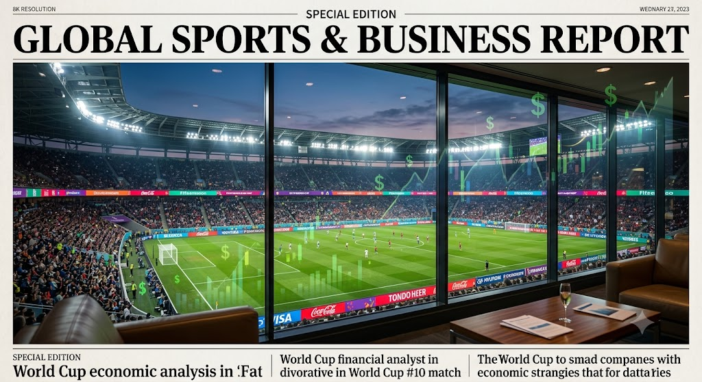
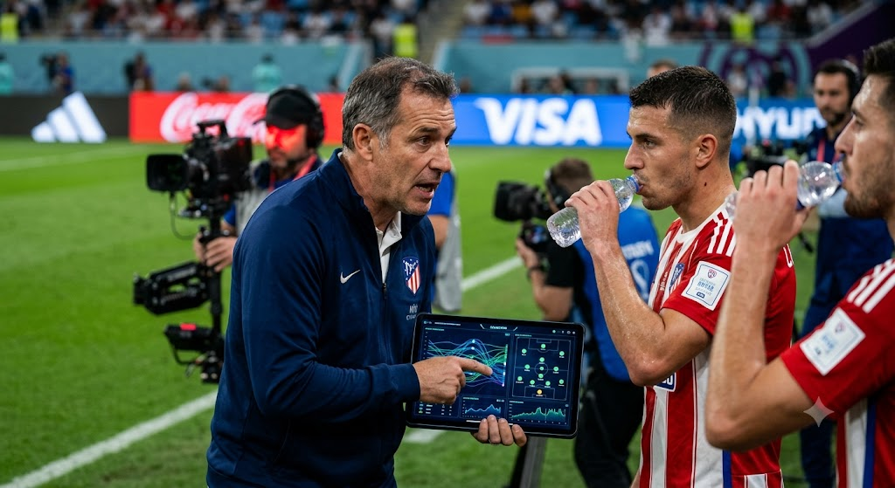

- **2026 북중미 월드컵에 전면 도입된 '하이드레이션 브레이크(Hydration Break)'는 단순한 선수 휴식을 넘어 글로벌 스포츠 자본주의의 새로운 수익 창출 플랫폼으로 자리매김했다.**
- FIFA는 고강도 활동에 따른 선수들의 심부 체온 상승을 막고 생리학적 부하를 줄인다는 '선수 보호'를 전면에 내세웠다.
- 하지만 실질적으로 이 제도는 전·후반 22분에 경기를 공식적으로 중단시킴으로써, 90분 내내 쉴 틈 없이 전개되던 전통적인 축구의 연속성을 자본의 통제 아래로 편입시켰다.
- 스포츠 경제 전문가들은 전 세계 시청자의 이목이 집중되는 이 3분의 확정적 중단 시간이 중계권, 광고, 데이터 산업에 미치는 경제적 파급 효과를 최소 10조 원 이상으로 추산하고 있다.
- **가장 극적인 변화를 맞이한 곳은 전후반 각각 3분씩 확정적으로 부여된 초고단가 프리미엄 광고 슬롯(Commercial Break)을 확보하게 된 글로벌 방송 및 중계권 시장이다.**
- 과거 심판의 재량에 맡겨졌던 '쿨링 브레이크'는 발생 여부와 시점이 불확실해 방송사들이 선제적으로 광고 상품을 기획하고 판매하는 데 한계가 있었다.
- 그러나 기온과 무관하게 22분에 의무적으로 발동되는 이번 규정은, 북미 스포츠에서 흔히 볼 수 있는 '쿼터제(Quarter System)'의 경제적 이점을 축구에 완벽히 이식했다.
- 미국 폭스 스포츠(Fox Sports)와 국내 지상파 등 글로벌 중계사들은 이른바 '22분 골든 타임어택'이라는 새로운 패키지를 신설해 기존 하프타임 광고 단가를 상회하는 막대한 추가 수익을 올리고 있다.
- **경기 중단 시간 동안 벤치의 전술 개입이 공식화되면서, 실시간 스포츠 데이터 분석 및 라이브 베팅 산업 역시 전례 없는 기하급수적 팽창을 경험하고 있다.**
- 감독들이 테크니컬 에어리어에 선수들을 모아놓고 태블릿 PC와 전술 보드를 활용해 실시간으로 포메이션을 수정하면서, 경기의 흐름은 22분을 기점으로 완전히 새로운 국면을 맞이하게 된다.
- 이에 따라 '브레이크 직후 첫 15분간의 득점 확률', '전술 변화에 따른 특정 선수의 패스 성공률 변화' 등을 실시간으로 분석하여 제공하는 AI 기반 스포츠 데이터 기업들의 기업 가치가 폭등하고 있다.
- 유럽과 북미의 합법적 스포츠 라이브 베팅 시장에서는 이 3분의 시간 동안 배당률이 실시간으로 요동치며 전 세계 자본이 단기간에 집중되는 현상이 매 경기 목격되고 있다.

- **글로벌 스폰서와 국내 대기업들은 시청자들의 시선이 그라운드에 고정된 이 정지된 시간을 선점하기 위해 기존에 없던 파격적인 '마이크로 타겟팅(Micro-targeting)' 마케팅을 쏟아내고 있다.**
- 선수들이 벤치로 다가와 물을 마시는 장면이 전 세계에 생중계됨에 따라, 글로벌 스포츠 음료 브랜드와 생수 기업들은 수백억 원의 후원금을 기꺼이 지불하며 자사 로고 노출에 사활을 걸고 있다.
- 국내 가전 및 IT 기업들 역시 브레이크가 시작되는 타이밍에 맞춰 TV 화면 하단이나 모바일 중계 앱의 팝업 띠 배너를 점유하는 '3분 숏폼(Short-form) 광고' 입찰 경쟁에 적극적으로 뛰어들었다.
- 소셜 미디어(SNS) 플랫폼들은 이 시간 동안 팬들이 실시간으로 경기에 대한 의견을 나누고 밈(Meme)을 생성할 수 있도록 유도하여 트래픽을 극대화하는 보조 스크린(Second screen) 전략을 강화하고 있다.
- **FIFA는 선수 보건이라는 현대 의학적 명분으로 거대 자본에 의한 축구의 상업화 논란을 효과적으로 방어하고 있으나, 전통주의자들의 거센 비판은 여전히 해결해야 할 숙제다.**
- 축구 순혈주의자들과 유럽의 정통 스포츠 매체들은 결정적인 공격 흐름이 인위적인 휘슬에 의해 단절되는 현상을 두고 '축구의 낭만과 예술성이 자본주의에 굴복했다'며 날을 세우고 있다.
- 주심이 공격권의 전개 상황을 고려해 22분에서 최대 27분 사이로 중단 시점을 유연하게 조율하며 비판을 불식시키려 노력하고 있으나, 특정 팀의 템포가 끊기는 피해 사례가 발생할 때마다 형평성 논란이 제기된다.
- 그럼에도 불구하고 이 제도는 선수 혹사 논란을 원천 차단한다는 점에서 명분과 실리를 모두 챙긴 FIFA 역사상 가장 성공적인 '규제적 프레이밍(Framing)' 사례로 기록될 가능성이 높다.
- **결론적으로 하이드레이션 브레이크는 2026 월드컵을 기점으로 전 세계 주요 프로 리그로 빠르게 확산되며 글로벌 스포츠 경제의 거스를 수 없는 '새로운 표준(New Normal)'이 될 것이다.**
- 이미 막대한 추가 수익의 맛을 본 방송사와 스폰서들은 월드컵 종료 이후에도 잉글랜드 프리미어리그(EPL)와 챔피언스리그 등 주요 상업 리그에 이 제도의 영구 도입을 강하게 압박할 것이다.
- 구단과 감독들 역시 선수들의 체력 안배와 정교한 전술 운영을 위해 이 제도의 일상화를 환영하는 분위기가 지배적이다.
- 90분이라는 멈추지 않는 시간의 성역은 마침내 허물어졌으며, 축구 산업은 이제 '끊어진 3분'이 만들어내는 수조 원의 경제적 부가가치를 중심으로 빠르게 재편되고 있다.
