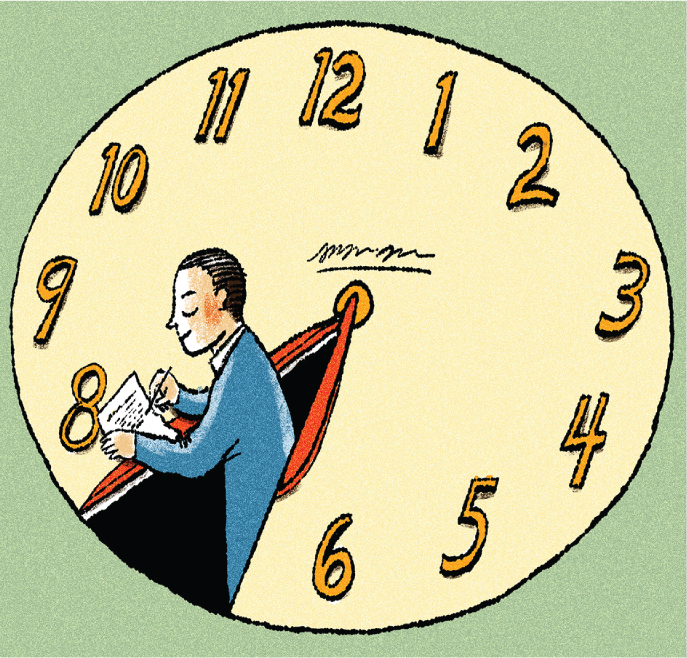

# **📌 박제를 위한 기록**

몇 년 전에 후배의 페이스북 포스팅을 통해 알게 된 글인데, 슬럼프에 빠져 있었던 시기에 벗어나기 위해 참고했던 좋은 글이다.

이 글의 제목은 **The 1-hour workday**. 초임 교수 시절 연구·강의·회의·논문·육아 등에 치여 정신 없이 지내던 저자가, 어려움에서 벗어나기 위해 **매일 1시간씩 논문을 쓴 경험**을 소개하는 글이다.

- 원문: https://science.sciencemag.org/content/353/6300/718
- PDF: https://science.sciencemag.org/content/sci/353/6300/718.full.pdf
- 한국어 번역: https://madscientist.wordpress.com/2016/11/16/%EB%A7%A4%EC%9D%BC-%ED%95%9C-%EC%8B%9C%EA%B0%84%EC%94%A9-%EB%85%BC%EB%AC%B8-%EC%93%B0%EA%B8%B0/
---

---

최근 이 글을 다시 찾게 되었고, 또 찾게 될 것 같아 이렇게 기록으로 남겨둔다.

- 한때 이 글을 참고해 **“5:55 프로젝트”**를 했던 적이 있다.
매일 새벽 5:55에 일어나 커피를 마시고 약 1시간 동안 생산적인 일을 하는 루틴이었다.

- 하지만 시간이 흐르며 기록을 이리저리 남겨 놓다 보니 반복해서 찾아야 했고, 그래서 아예 박제해두기로 결심했다.
---

**📄 The 1-hour workday 번역본**

# **📄  The 1-hour workday 번역본**

**Jeffrey J. McDonnell, Science (2016.08.12)**

---

조교수였던 시절, 나는 늘 압도당한다는 느낌 속에서 살았다. 강의 준비, 새로 만난 동료들과의 관계 형성, 연구실 구성, 집에서는 갓난아이 돌보기까지—그 와중에도 연구를 진행하고 논문을 써야 했다. 앞서 나가기 위해 주어지는 기회는 모두 붙잡았다. 각종 편집위원회와 학회 위원회에 얽매이는 일까지 포함해서 말이다. 정신없이 일했지만, 논문 생산성은 초라했다. **방해받지 않고 집중해서 글을 쓸 시간이 도무지 확보되지 않았기 때문이다.**

가끔 긴 시간 끝에 겨우 글을 시작하려 해도, 다시 논문에 몰입하기 위한 ‘워밍업’ 시간이 길어져 진행이 더욱 느려지곤 했다.

---

처음에는 이런 좌절감이 학계에서는 흔한 일이라고 생각했다. 하지만 시간이 지나면서, 놀라운 규칙성으로 꾸준히 논문을 발표하고 항상 새로운 논문을 진행 중인 선배들을 보게 되었다. 그들의 비결이 무엇인지 물었을 때, 그들이 공통적으로 강조한 것은 바로 “매일 조금씩, 집중해서 쓰는 것”이었다.

그래서 나도 나만의 방식을 만들었다. 나는 이것을 ‘1시간 근무일(1-hour workday)’라고 부른다. 학자로서 내가 생각하는 “진짜 일”—즉, 논문 쓰기를 하는 **짧지만 절대적으로 지켜야 하는 한 시간**을 의미한다.

---

## **🕐 하루의 첫 1시간을 지키는 의식**

하루 중 내가 정신적으로 가장 선명하고, 시간에 대한 통제권을 가장 많이 갖고 있는 때는 **아침**이다. 그래서 하루의 첫 시간을 오롯이 글쓰기에 사용하기로 했다.

나에겐 **집에서 하는 것이 가장 잘 맞았다.** 나름의 의식도 있다.

- 아침에 일찍 일어난다.
- 에스프레소를 내린다.
- 그리고 기운이 다 빠질 때까지, 혹은 이메일·마감·회의 등 방해 요소가 들이닥칠 때까지 쓴다.
보통 한 시간 정도다. 어떤 날은 조금 더 짧고, 어떤 날은 조금 길다.

그리고 골프처럼, 공을 잘 치려면 “티업(teed up)” 되어야 하듯, 글쓰기도 준비가 필요하다.

그래서 **전날 밤, 다음날 아침에 무엇을 쓸지 미리 정리해 둔다.**

캘린더에도 적고, 할 일 목록에도 **“어떤 논문, 어떤 섹션을 쓸지”** 구체적으로 적는다.

---

## **🔄 좌절 대신 성취로 하루가 채워지다**

이 루틴은 내 업무 인생을 완전히 바꿔놓았다.

예전에는 하루의 많은 순간이 좌절감으로 채워졌지만, 이제는 **아침 글쓰기만 끝내도 그날 어떤 일이 벌어지든 “무언가 성취했다”는 만족감을 느끼며 집으로 돌아갈 수 있다.**

글쓰기 실력도 마찬가지다.

나는 아직 글쓰기라는 게임을 완전히 마스터한 것은 아니지만, **1시간 루틴 덕분에 확실히 산출물은 늘었고, 글의 질도 좋아졌다.** 무엇보다 글쓰기 과정이 전보다 훨씬 즐거워졌다.

또한 이 시간은 **깊은 사고를 위한 기회**가 된다. 교수 생활을 처음 시작했을 때는 이런 생각의 시간이 거의 없었지만, 이제는 매일 키보드를 두드리는 그 시간이 새로운 아이디어의 씨앗이 된다. 글쓰는 날들이 이어지면, 아이디어가 흐르는 방식도 달라진다.

심지어 키보드를 떠난 시간—예를 들어 자전거를 타고 출근할 때나, 그냥 독서를 할 때조차—자연스럽게 생각이 연결되고 확장된다.

---

## **🏓 때로는 ‘핑퐁 게임’처럼**

많은 날, 글쓰기란 **다른 사람이 쓴 글을 편집하고 수정하는 것**이기도 하다. 이 작업은 때때로 지루하고 고역처럼 느껴지지만, 나는 이것을 **탁구 게임처럼** 생각하려 노력한다.

> “나의 목표는 상대의 서브를 받아 곧바로 되돌려 주는 것이다.”

이걸 빠르게 해내면, 전체 글쓰기라는 게임 자체가 훨씬 매끄러워진다.

---

## **🏋️ 운동처럼 유지해야 하는 글쓰기 근육**

어떤 운동이든, 체력이 떨어지면 금방 실력이 줄어든다.

글쓰기와 편집도 똑같다. **몇 일만 루틴을 놓쳐도 다시 시작하기가 훨씬 힘들어진다.**

그래서 수많은 방해 요소가 있어도, 나는 **하루의 첫 한 시간**을 지키기 위해 애쓴다.

글쓰기에는 길고 uninterrupted된 시간이 필요하지 않다는 것을 배웠다.

**중요한 것은 집중과 규칙성이다.**

나는 지금도 박사과정 학생들과 신임 교수들에게 이렇게 조언한다.

> “매일 글쓰기를 초기에 루틴으로 삼아라.

> 그래야 내가 겪었던 오랜 글쓰기 좌절을 반복하지 않을 수 있다.”

어떤 커리어 단계에 있든, **매일의 글쓰기 의식**은 성과를 향상시키고—아마도 가장 중요하게는—**일에 대한 만족도를 높일 수 있다.**

[원문 번역 끝]

---

# **🧩 일상 회복이 필요할 때**

이 글은 논문을 쓰지 않는 사람에게도 충분히 도움이 된다.

논문 쓰기를 **운동, 유튜브 제작, 블로그 글쓰기, 프로젝트 진행** 등으로 바꿔도 그대로 적용된다.

- 육아·직장생활 등 여러 레이어가 겹쳐 혼란스러운 시기에 특히 공감이 된다.
- 새로운 루틴이 필요할 때, 일상을 재정비하고 싶을 때 좋은 지침이 된다.
---

# **✍️ 핵심: 매일 한 시간씩 집중해서 조금씩 쓰기**

이 글은 한 문장으로 요약된다.

> “매일 한시간씩 집중해서 조금씩 써라.”

### **✔ 매일 (Consistency)**

- 습관처럼 매일 하라는 의미.
- 이 시간을 지키려면 가족, 동료의 협조가 필요하다.
- 저자의 말:
*“연습을 빼먹으면 폼이 나오지 않듯, 논문 쓰기 루틴도 매일 하지 않으면 점점 힘들어진다.”*

### **✔ 한 시간씩 (Manageable Time)**

- 과하지 않게, 일상을 해치지 않는 시간.
- 사람에 따라 30분~2시간 등 자신에게 맞게 조정 가능.
### **✔ 집중해서 (Deep Focus)**

- 방해받지 않는 시간.
- 저자: *“이메일이 오거나 마감이 들이닥치기 전까지 논문을 쓴다.”*
### **✔ 조금씩 (Incremental Progress)**

- 한 번에 큰 성과를 내려 하지 않고, 매일 조금씩 채워 나가는 방식.
- 우리말 ‘**시나브로**’ 같은 개념.
### **🗒️ 루틴을 돕는 팁**

- **전날 밤, 다음날 아침에 쓸 내용을 미리 정해둔다.**
→ 웜업 시간을 줄여 루틴 유지가 쉬워진다.

---

# **🌱 좌절로 채워진 일상이 성취로 채워지다**

이 루틴이 자리 잡으면 가장 큰 변화는 **일상에서 좌절이 줄고 성취가 늘어난다**는 것.

- “얼마나 했든 성취했다는 느낌을 가지고 집에 가게 된다.”
- “학문적 아웃풋이 증가했고, 논문의 질도 좋아졌다.”
- “며칠 잘 쓰고 나면, 자전거를 타는 도중에도 아이디어가 자연스럽게 떠오른다.”
### **🎾 ‘핑퐁 게임’처럼 일하기**

저자는 공동 작업 역시 탁구처럼 **받으면 바로 넘겨주는 방식**이 효과적이라고 강조한다.

> “내 목표는 서브를 리시브해 바로 되돌려 주는 것이다.

> 이것을 빨리하면 논문 쓰기 전체 게임이 향상된다.”

참고 영상: https://www.youtube.com/watch?v=Sg3FtVszntI

---

# **🔑 집중과 규칙이 만드는 변화**

매일 집중할 수 있는 1시간이 큰 변화를 만든다.

- 반복되는 일상에서 무료함, 나태함을 끊어내는 힘
- 불확실한 미래로 인한 고민을 덜어주는 안정감
- 새로운 시작을 위한 터닝 포인트
언젠가 또 이 글을 다시 찾아보겠지만, 이 기록을 계기로 다시 마음을 잡아보자.

---

