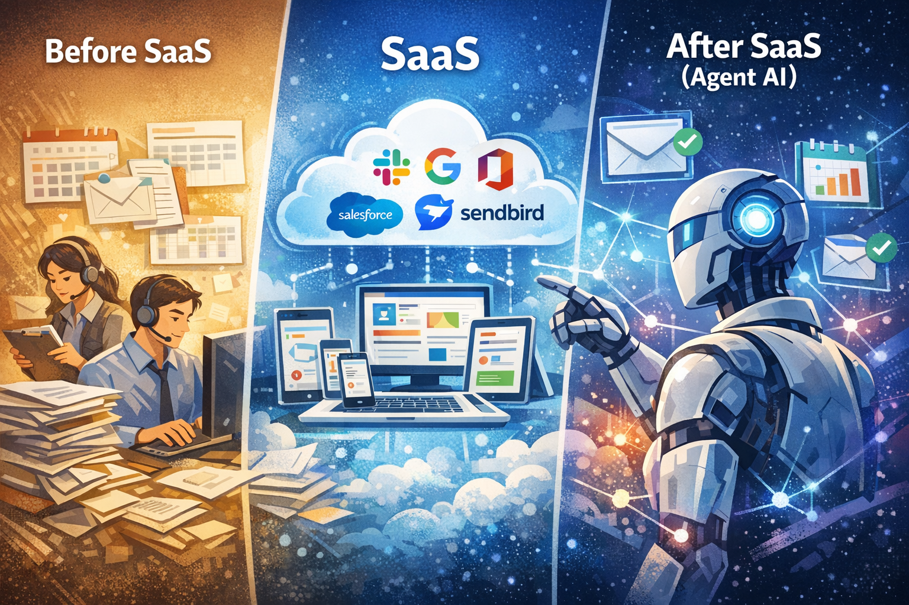
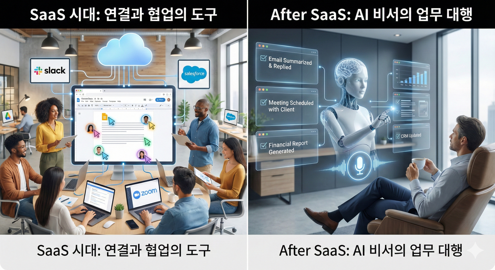

---

# **AI Eats Everything: 소프트웨어는 어떻게 진화하는가**

---

2011년, 마크 앤드리슨(Marc Andreessen)이 월스트리트저널에 유명한 글을 썼다. **"Software is Eating the World."** 소프트웨어가 세상의 모든 산업을 집어삼키고 있다는 선언이었다. 서점은 아마존에, 음반사는 스포티파이에, 택시는 우버에 잡아먹혔다.

14년이 지난 지금, 새로운 문장이 필요하다.

**"AI is Eating Everything—Including Software."**

AI는 세상만 먹는 게 아니다. 소프트웨어 자체를 먹고 있다.

---

## **Before SaaS: CD 사서 설치하던 시절**

2000년대 초반까지, 소프트웨어는 "물건"이었다.

마이크로소프트 오피스를 쓰려면 용산 전자상가에서 CD를 사야 했다. 가격은 수십만 원. 설치하는 데 30분. 새 버전이 나오면 또 돈 주고 새 CD를 사야 했다. 기업용 소프트웨어는 더 심했다. 회계 프로그램, 고객 관리 시스템을 도입하려면 서버를 사고, 전산실을 만들고, 유지보수 인력을 고용해야 했다. 수억 원이 들었다.

**문제점:**

- 초기 비용이 너무 큼 (서버, 라이선스, 설치)
- 업데이트할 때마다 돈과 시간 소모
- 소규모 기업은 엄두도 못 냄
---

## **SaaS: "설치 대신 구독, 소유 대신 접속"**

2000년대 중반, 판도가 바뀐다. **"소프트웨어를 사는 게 아니라 빌린다"**는 개념이 등장한다.

Salesforce(1999년 창업)가 선구자였다. "소프트웨어의 종말(No Software)"을 외치며, 고객 관리 시스템을 웹 브라우저로 제공했다. 서버 살 필요 없음. 설치할 필요 없음. 그냥 로그인하면 된다. 월 사용료만 내면 항상 최신 버전이다.

이게 **SaaS(Software as a Service)**다.

### **대표적인 SaaS 서비스들**

<!-- notion-table: column_header=false row_header=false -->
| **분야**    | **서비스**                      | **대체한 것**                   |
|:----------|:-----------------------------|:----------------------------|
| 문서/생산성    | Google Docs, MS 365, Notion  | 로컬 오피스 프로그램 (한글, MS 오피스 CD) |
| 협업/소통     | Slack, Zoom, Microsoft Teams | 이메일 + 회의실 + 전화              |
| 고객관리(CRM) | Salesforce, HubSpot          | 엑셀 고객 명단 + 영업 담당자 수첩        |
| 인사관리(HR)  | Workday, flex                | 종이 근태장부 + 인사팀 엑셀            |
| 개발 인프라    | AWS, Sendbird, Twilio        | 자체 서버실 + 개발팀                |

### **SaaS가 성공한 공식**

**"사람 한 명 월급 < 소프트웨어 월 구독료"**

- 고객 관리 담당자 월급: 300만 원
- Salesforce 월 구독료: 10만 원
마진율 70~80%. 한번 만들면 복제 비용 거의 0원. 돈 찍어내는 구조였다.

**하지만 숨겨진 전제가 있었다.**

누군가는 여전히 타이핑을 해야 한다.

Salesforce가 아무리 좋아도, 영업사원이 미팅 끝나고 "김 부장, 예산 검토 중, 다음 주 2차 미팅"이라고 직접 입력해야 했다. Notion이 아무리 편해도, 누군가 회의록을 정리해서 써야 했다. Slack이 아무리 빨라도, 사람이 메시지를 읽고 판단하고 답장해야 했다.

SaaS는 **"일하는 사람"을 대체한 게 아니라, "일하는 사람의 도구"**를 판 것이다.

---

## **After SaaS: Agent AI가 바꾸는 것**

2024년, 다시 판도가 바뀌고 있다. AI가 **"타이핑하는 사람"**마저 대체하기 시작했다.

### **각 SaaS가 받는 타격**

**1. Salesforce, HubSpot (CRM)**

- Before AI: 영업사원이 미팅 끝나고 CRM 열어서 내용 입력
- After AI: 미팅 녹음하면 AI가 알아서 요약해서 CRM에 입력. "김 부장, 예산 3억 검토 중, 경쟁사 B도 만나는 중, 2주 내 결정 예정"까지 자동 기록.
→ 영업사원이 Salesforce 화면을 열 이유가 사라진다.

**2. Notion, Google Docs (문서/생산성)**

- Before AI: 회의 끝나고 누군가 30분 들여서 회의록 작성
- After AI: Zoom 녹화본을 AI에 던지면 3분 만에 회의록 완성. 액션 아이템까지 정리됨.
→ "예쁜 문서 편집기"의 가치가 줄어든다. 어차피 AI가 작성하니까.

**3. Slack, Teams (협업/소통)**

- Before AI: 메시지 읽고, 판단하고, 답장하는 건 사람 몫
- After AI: AI가 채널 전체를 읽고 "오늘 중요한 건 이 3개"라고 요약. 단순 질문은 AI가 대신 답변.
→ Slack을 스크롤하며 읽는 시간 자체가 사라진다.

**4. Workday, flex (HR)**

- Before AI: 인사팀이 수작업으로 휴가 승인, 급여 정산, 평가 관리
- After AI: "다음 주 휴가 써도 될까요?"라고 말하면 AI가 잔여 휴가 확인하고 승인 처리까지.
→ HR 시스템 화면을 열 필요가 없다.

### **핵심: "화면을 여는 행위" 자체가 사라진다**

기존 SaaS의 가치는 두 가지였다:

1. 데이터를 **입력**하는 곳
1. 데이터를 **확인**하는 곳
AI는 둘 다 필요 없게 만든다.

- 입력? AI가 알아서 한다.
- 확인? AI가 요약해서 카톡이나 이메일로 보내준다.
**기존 SaaS는 "예쁜 인터페이스"의 가치를 잃고, 그냥 백엔드 데이터베이스로 전락할 수 있다.**

---

## **그래서 기회는 어디에?**

<!-- notion-table: column_header=false row_header=false -->
| **구분**   | **시장 규모**   | **설명**                         |
|:---------|:------------|:-------------------------------|
| SaaS 시장  | 1조 달러       | 반복적·구조화된 업무 (소프트웨어로 대체 가능했던 것) |
| 서비스 산업   | 16조 달러      | 상황 판단이 필요한 업무 (사람만 할 수 있었던 것)  |

지난 20년간 SaaS가 먹은 시장은 **"소프트웨어화 가능했던"** 1조 달러다.

하지만 세상에는 소프트웨어가 못 건드린 16조 달러가 있다:

- **콜센터**: 고객 감정 파악, 예외 상황 판단
- **병원 원무과**: 케이스마다 다른 보험 청구
- **IT 외주 개발**: 창의적 문제 해결
- **법률/회계 서비스**: 복잡한 맥락 이해
이 일들은 "상황 판단"이 필요해서 소프트웨어가 못 했다. 그래서 사람이 했고, 그래서 비쌌다.

**Agent AI는 이 상황 판단이 가능하다.**

경쟁의 축이 바뀐다:

<!-- notion-table: column_header=false row_header=false -->
| **시대**   | **경쟁의 본질**    | **예시**                 |
|:---------|:--------------|:-----------------------|
| SaaS 시대  | 더 좋은 소프트웨어    | Notion vs Evernote     |
| AI 시대    | 사람을 대체하는 에이전트 | AI 콜센터, AI 회계사, AI 개발자 |

"더 예쁜 CRM"을 만드는 건 이제 의미가 작다. 어차피 사람이 그 화면을 안 볼 테니까.

진짜 기회는 **"그동안 소프트웨어가 못 건드렸던, 사람만 할 수 있었던 일"**을 AI로 대체하는 것이다.

---

## 정리: 세 시대의 비교

|            | Before SaaS    | SaaS          | After SaaS (Agent AI)   |
|:-----------|:---------------|:--------------|:------------------------|
| **비유**     | 집을 직접 지음       | 호텔 방을 빌림      | **집사가 모든 걸 관리함**        |
| **형태**     | CD 패키지 / 설치    | 웹 로그인 / 구독    | **대화형 AI / 자동화**        |
| **역할**     | 기능 제공          | 효율적인 도구       | **업무 대행 (Agent)**       |
| **대체 대상**  | 종이·수작업         | 전담 인력 일부      | 서비스직 전체                 |
| **사람의 역할** | 설치·유지보수 + 사용   | 사용 (입력·확인)    | 감독·최종 판단                |
| **핵심**     | 소유 (Ownership) | 접속 (Access)   | **결과 (Outcome)**        |
| **비용 구조**  | 수천만~수억 (초기 투자) | 월 수만~수십만 (구독) | 결과당 과금? (미정)            |

## **Software Eats the World → AI Eats Everything**

앤드리슨의 예언은 맞았다. 소프트웨어는 정말로 세상을 집어삼켰다.

그런데 그 소프트웨어마저 지금 잡아먹히고 있다. SaaS는 "도구를 싸게 제공"했다. AI는 "도구를 쓰는 사람"까지 대체한다.

**Software ate the world. Now AI is eating software.**

게임의 규칙이 바뀌고 있다.

