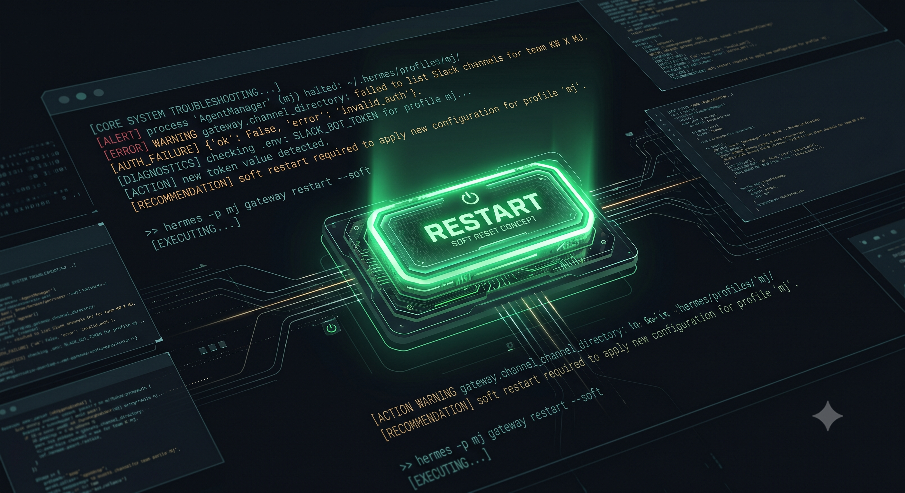

## Attaching Agents to Multiple Slack Workspaces with Hermes Multi-Profile

A write-up of how to run several Hermes Agent instances on a single machine, one per profile, and connect each profile to a different Slack workspace. While attaching one particular profile (`custom_profile`) to a new workspace (`New_Workspace`, team `T_NEW`), I lost a good while to a "looks connected but never replies" symptom, and the cause turned out to be an invalid Slack bot token (`invalid_auth`). I'm recording the whole process here so I don't get stuck in the same place the next time I create more profiles.

### 1. The big picture: what a profile is and why you'd use one

A Hermes profile is a fully isolated instance. Each profile has its own `HERMES_HOME` directory — config, API keys (`.env`), session DB, memory, skills, even gateway state are all kept separate.

- **Default (root) instance** → `~/.hermes/`
- **Named profile** → `~/.hermes/profiles/<name>/`
Internally, when you pass `hermes -p <name> ...`, `_apply_profile_override()` swaps `HERMES_HOME` over to that profile's folder **before any module is imported**. That's why `get_hermes_home()` is automatically scoped to that profile everywhere in the code.

The key effect: you can run a separate gateway per profile, and each gateway attaches to a different messenger account/workspace. On our machine, two are running at the same time right now.

```plain text
PID 93729   root gateway   → Slack: main_workspace.slack.com (team T_MAIN)
PID 71720   custom_profile profile gateway → Slack: New_Workspace (team T_NEW)
```

Having both gateways up together is normal. As long as they're properly isolated, they don't conflict. That "as long as they're properly isolated" is the heart of the trap — see sections 4 and 6 below.

### 2. Creating a new profile (step by step)

**1) Create the profile**

```plain text
hermes profile create <name>          # e.g. hermes profile create custom_profile
hermes profile list                   # confirm it was created
```

**2) Configure in this profile's context (`-p <name>` on every command)**

```plain text
hermes -p <name> setup                # full setup wizard (model/tools/gateway all at once)

# or just the messenger:
hermes -p <name> gateway setup        # set up only platforms such as Slack/Telegram
```

**3) Run the gateway**

```plain text
hermes -p <name> gateway run          # run in the foreground
hermes -p <name> gateway run --replace  # run, replacing the existing instance
hermes -p <name> gateway status       # check status
```

- Profile-related subcommands: `create`, `list`, `switch`, `use`, `delete`.
- **Caution:** `hermes profile delete <name>` wipes that profile's entire `HERMES_HOME` (sessions and memory included). Don't use it carelessly.
### 3. The two Slack tokens — where 90% of people get stuck

Hermes's Slack integration is based on Socket Mode and needs two kinds of token. The key point is that they play different roles and are valid or invalid independently of each other.

<!-- notion-table: column_header=false row_header=false -->
| **.env key** | **Token format** | **Purpose** | **Where it's issued** |
|:--------------------|:------------|:-----------------------------|:-------------------------------------------------------------------------|
| **SLACK_APP_TOKEN** | `xapp-...` | Receiving events (Socket Mode connection) | Slack app → Basic Information → App-Level Tokens (`connections:write` scope) |
| **SLACK_BOT_TOKEN** | `xoxb-...` | Web API calls (sending messages, listing channels, etc.) | Slack app → OAuth & Permissions → Bot User OAuth Token (issued when installed to the workspace) |

*Other things you'd usually set alongside them:*

- `SLACK_HOME_CHANNEL` — default reply channel/DM ID (e.g. `C0B5M...`)
- `SLACK_ALLOWED_USERS` — list of allowed user IDs (e.g. `U1923...`)
**Why they're split in two**

- xapp (the app-level token) is tied to the app itself. It usually survives even if you reinstall the app to the workspace. → Socket Mode keeps connecting.
- xoxb (the bot token) is tied to "the instance of this app installed in this workspace." Reinstall the app or regenerate the token and the value changes. The old value becomes invalid immediately.
- **As a result**, it's far too easy to end up in a mismatched state where xapp is right and only xoxb is wrong. That is exactly the symptom we hit.


### 4. The symptom we hit, and the diagnosis

**Symptom**

- The bot appears to be authenticated to the workspace. DMs/mentions come in too (the channel directory updates in real time).
- But it doesn't reply. It felt like it "was working, then stopped and got tangled."
**What was actually happening**

The gateway log had this showing up every 5 minutes, more than 1,400 times:

```plain text
WARNING gateway.channel_directory: Channel directory: failed to list Slack channels
for team T_NEW: ... (url: https://slack.com/api/users.conversations, status: 200)
The server responded with: {'ok': False, 'error': 'invalid_auth'}
```

And it had been broken from the very moment of the first authentication log:

```plain text
2026-05-22 15:00:14 INFO  gateway.platforms.slack: [Slack] Authenticated as @bot_name
                          in workspace New_Workspace (team: T_NEW)   ← Socket Mode(xapp) OK
2026-05-22 15:00:14 WARN  ... users.conversations ... invalid_auth ← Web API(xoxb) failed
```

<!-- notion-table: column_header=false row_header=false -->
| **Token** | **Status** |
|:---------------------------|:----------------------------------------------------|
| **SLACK_APP_TOKEN (xapp)** | ✅ Fine — authenticated to `New_Workspace` via Socket Mode → events come in |
| **SLACK_BOT_TOKEN (xoxb)** | ❌ `invalid_auth` — every reply/lookup API call fails |

In other words, a half connection that can only receive and can't send. It was all the more confusing because it looked connected from the outside.

**The decisive check — auth.test**

You can tell whether a token is valid in one second with Slack's `auth.test` (read-only). **Don't print the token to the screen**; read it straight from `.env` and pass it in the header:

```plain text
cd ~/.hermes
tok() { grep -E "^$2=" "$1" | head -1 | cut -d= -f2- | sed -e 's/^["'\'']//' -e 's/["'\'']$//'; }

# bot token of the profile to verify
curl -s -X POST https://slack.com/api/auth.test \
  -H "Authorization: Bearer $(tok profiles/custom_profile/.env SLACK_BOT_TOKEN)" | python3 -m json.tool
```

- **If it's valid:**JSON
```plain text
{ "ok": true, "url": "https://....slack.com/", "team": "...", "team_id": "T...", "user": "hermes", "bot_id": "B..." }
```

- **If it's invalid:**JSON
```plain text
{ "ok": false, "error": "invalid_auth" }
```

Our case: `custom_profile` bot token → `invalid_auth`, root bot token → `ok: true`. Done. Culprit confirmed.

**The fix**

1. `New_Workspace` Slack app → OAuth & Permissions → copy the latest Bot User OAuth Token (`xoxb-`) value. (If you reinstalled the app or regenerated the token, the value will have changed.)
- ⚠️ This bot token must belong to the same app as the app token (`xapp`) you're currently using. Mix tokens from different apps and you get exactly this symptom (Socket connects but the Web API returns `invalid_auth`).
1. Replace `SLACK_BOT_TOKEN` in `~/.hermes/profiles/custom_profile/.env`.
1. Restart the gateway (section 5 below — I went around in circles twice because I skipped this).
1. Re-run `auth.test` → once you see `ok: true`, you're done.
### 5. The second trap: fix .env without restarting and nothing changes

The gateway reads `.env` into memory at startup. A running process doesn't pick up any later edits to `.env`. Our timeline was exactly this:

```plain text
custom_profile gateway started:   2026-05-22 15:18
custom_profile .env last modified:  2026-05-22 22:30   ← after startup! → not picked up by the running process
```

Even after you fix the token, the gateway is still holding on to the old one, so it keeps looking broken. → If you've touched `.env`, always restart.

```plain text
hermes -p custom_profile gateway restart      # recommended

# or
hermes -p custom_profile gateway run --replace # run in the foreground, replacing the existing instance
```

⚠️ `gateway stop/restart --all` kills the gateways of every profile. The root gateway goes down with them, so when you're only working on one specific profile, leave out `--all` and pass just `-p <name>`.

### 6. The third trap: sharing tokens across profiles = lock conflict

The gateway platform adapters take a scoped lock on each unique credential (bot token). If two profiles use the same token, whichever starts later gets blocked. We ran into this early on too, because `custom_profile` was using the same Telegram bot token as root:

```plain text
telegram: state=fatal  error=telegram-bot-token_lock
  "Telegram bot token already in use (PID 93729). Stop the other gateway first."
```

- **Principle:** each profile gets its own separate credentials for a given platform.
- For Slack, that means a different Slack app + a different xapp/xoxb pair per workspace.
- For platforms you don't use, remove the token from that profile's `.env` altogether (we got rid of the lock by removing the Telegram token from `custom_profile`).
Note: `gateway_state.json` is only updated on state transitions. A value from days ago can still be sitting there, stale, so always cross-check the current state against the logs.

### 7. Diagnostic recipe (next time you're stuck, go in this order)

```plain text
# 0) How many gateways are up, and under which profiles
ps aux | grep -E "hermes.*gateway" | grep -v grep

# 1) Gateway status for the profile in question
hermes -p <name> gateway status --deep

# 2) Live error log (the most informative)
tail -f ~/.hermes/profiles/<name>/logs/gateway.error.log
#   invalid_auth        → bot token invalid (section 4)
#   *_lock / already in use → token-sharing conflict (section 6)
#   channel_not_found   → wrong HOME_CHANNEL/target channel ID

# 3) Verify token validity directly (read-only)
curl -s -X POST https://slack.com/api/auth.test \
  -H "Authorization: Bearer $(grep ^SLACK_BOT_TOKEN ~/.hermes/profiles/<name>/.env | cut -d= -f2-)" \
  | python3 -m json.tool

# 4) .env modification time vs. process start time (to judge whether a restart is needed)
stat -f "%Sm  %N" ~/.hermes/profiles/<name>/.env
ps -o pid,lstart -p <gateway_pid>
```

When you only want to compare tokens (without exposing them), check that they're identical using just the first 8 characters of the sha256:

```plain text
python3 -c "import hashlib,sys; print(hashlib.sha256(sys.argv[1].encode()).hexdigest()[:8])" "<token>"
```

### 8. Checklist for the next profile

[ ] `hermes profile create <name>`
[ ] Create a new Slack app for each new workspace (no reusing an existing app).
[ ] Issue an App-Level Token (`xapp`, `connections:write`) from that app → `SLACK_APP_TOKEN`
[ ] Install that app to the workspace, then copy the Bot User OAuth Token (`xoxb`) → `SLACK_BOT_TOKEN`
[ ] Confirm that `xapp` and `xoxb` belong to the same app (mix them and you get `invalid_auth`).
[ ] Set `SLACK_HOME_CHANNEL` and `SLACK_ALLOWED_USERS`.
[ ] Don't share tokens with other profiles. Remove tokens for unused platforms from `.env`.
[ ] Save `.env` → first confirm `ok:true` with `auth.test` → only then start the gateway.
[ ] If you edit `.env` later → `gateway restart` (never `-all`, just `p <name>`).
[ ] Check that there's no `invalid_auth` / `_lock` in `gateway.error.log`.
### 9. Appendix

**Profile directory structure**

```plain text
~/.hermes/                      # root (default) instance = HERMES_HOME
└── profiles/<name>/            # per-profile HERMES_HOME (fully isolated)
    ├── .env                    # API keys/tokens (profile-only)
    ├── config.yaml             # configuration
    ├── state.db                # session DB
    ├── gateway_state.json      # gateway state snapshot (may be stale)
    ├── gateway.pid / .lock     # process/lock
    ├── channel_directory.json  # list of incoming channels (updated in real time)
    ├── logs/                   # gateway.log, gateway.error.log, agent.log, errors.log
    ├── memories/ · skills/ · cron/ · sessions/
    └── SOUL.md                 # persona (default personality if left empty)
```

**Command reference**

```plain text
hermes profile create|list|switch|use|delete <name>
hermes -p <name> setup                 # full setup wizard
hermes -p <name> gateway setup         # messenger platform setup
hermes -p <name> gateway run [--replace] [-q]
hermes -p <name> gateway start|stop|restart [--all] [--system]
hermes -p <name> gateway status [--deep] [-l/--full]
```



**One-line summary**

If Socket Mode (`xapp`) connects but the bot doesn't reply, nine times out of ten the `xoxb` bot token is invalid. Check it instantly with `auth.test`, and if you've fixed `.env`, don't forget to restart the gateway. Give each profile and workspace its own pair of tokens from the same app, and never share them.
