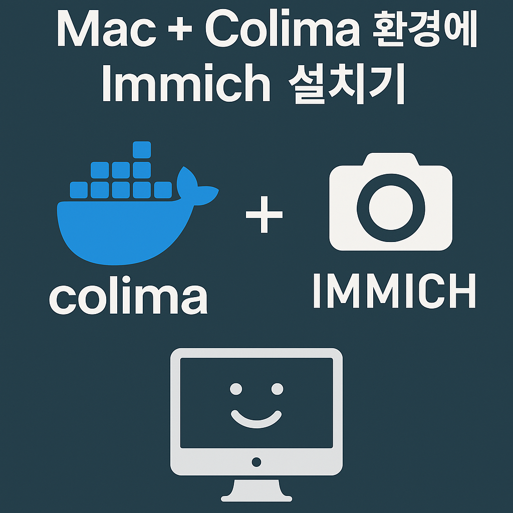

---


**1. 배경: 왜 Immich인가?**

우리는 아이들 사진을 수천 장씩 찍는 평범한 부모다. 그런데 구글 포토 무료 용량이 한계에 다다르자, 개인 사진 서버의 필요성이 생겼다.
**Synology** 같은 NAS도 고려했지만, 맥미니 + 외장 SSD 2TB 세트가 이미 있으니 Docker 기반의 **Immich** 설치를 선택했다.

📌 참고: [Immich 공식 사이트](https://immich.app)


**2. 준비 환경**

- **맥미니 M1**
- **Colima** (Docker 대체 VM 환경)
- **외장 SSD 2TB (USB-C로 연결)**
- iPhone, Galaxy에서 접근 가능해야 함
- Docker, Docker Compose 설치 완료


**3. Immich 설치 (첫 시도)
**
```bash
git clone https://github.com/immich-app/immich.git
cd immich
./install.sh

설치 직후, docker-compose.yml과 .env 파일이 생성된다.

---


**4. 수많은 에러들 그리고 해결 방법**

**🧱 1) Keychain 에러**

```plain text
error getting credentials - err: exit status 1, out: `keychain cannot be accessed...
```

🔧 해결 방법:

```plain text
security unlock-keychain ~/Library/Keychains/login.keychain-db
```

> 매번 비밀번호 치기 귀찮다면? eval $(keychain --eval id_rsa)처럼 keychain 연동 스크립트를 zshrc에 추가.

---

**🧱 2) Permission Denied: postgres**

```plain text
chown: changing ownership of '/var/lib/postgresql/data': Permission denied
```

🔧 해결 방법:

Colima에서 마운트된 디렉토리는 Docker 내부에서 권한 문제가 발생한다.

PostgreSQL 컨테이너는 UID=999이므로, 로컬에서도 이 권한을 부여해줘야 한다.

```plain text
sudo rm -rf ./postgres
mkdir ./postgres
sudo chown -R 999:999 ./postgres
sudo chmod -R 700 ./postgres
```

```plain text
<!-- 이미지 위치: postgres 권한 에러와 권한 설정 비교 스크린샷 -->
```

---

**🧱 3) Port already in use**

```plain text
Error: Bind for 0.0.0.0:2283 failed: port is already allocated
```

🔧 해결 방법:

```plain text
docker ps --filter "publish=2283"
docker rm -f [컨테이너 ID]
```

또는 docker compose down --volumes로 완전 초기화.

---

**🧱 4) Container 유령 캐시**

```plain text
Error response from daemon: No such container: eab657de...
```

🔧 해결 방법:

```plain text
docker system prune -af --volumes
```

---

**5. Colima와 Immich의 궁합**

Colima를 사용할 때는 colima start 전에 .colima/default/colima.yaml에 아래 설정을 권장:

```plain text
mounts:
  - location: ~/study/immich
    writable: true
```

또는 --mount ~/study/immich:w 옵션으로 명시적으로 마운트.

---

**6. 최종 docker-compose 실행**

```plain text
docker compose -p immich_final up --build --remove-orphans -d
```

📌 포트 2283이 열려 있어야 내부 네트워크에서 모바일 앱으로 접속 가능.

```plain text
http://<macmini 내부 IP>:2283
```

•	iPhone과 Android에서 Immich 앱 설치 후, 위 URL 입력

•	업로드 권한, 관리자 권한 설정 가능

```plain text
<!-- 이미지 위치: Immich 앱에서 내부 IP로 접속하는 화면 -->
```

---

**7. 마무리**

•	홈서버로 사진 백업을 완전 자동화

•	Immich는 딥러닝 기반 얼굴 인식, 중복 제거, 공유 앨범 기능까지 갖춘 강력한 대안


---

**📸 캡처 및 이미지 목록**

•	postgres 권한 에러 로그 vs 해결 후 정상 로그

•	Colima 설정 화면

•	Immich 앱 접속 화면

•	macmini에서 docker-compose 실행 터미널 로그

---

