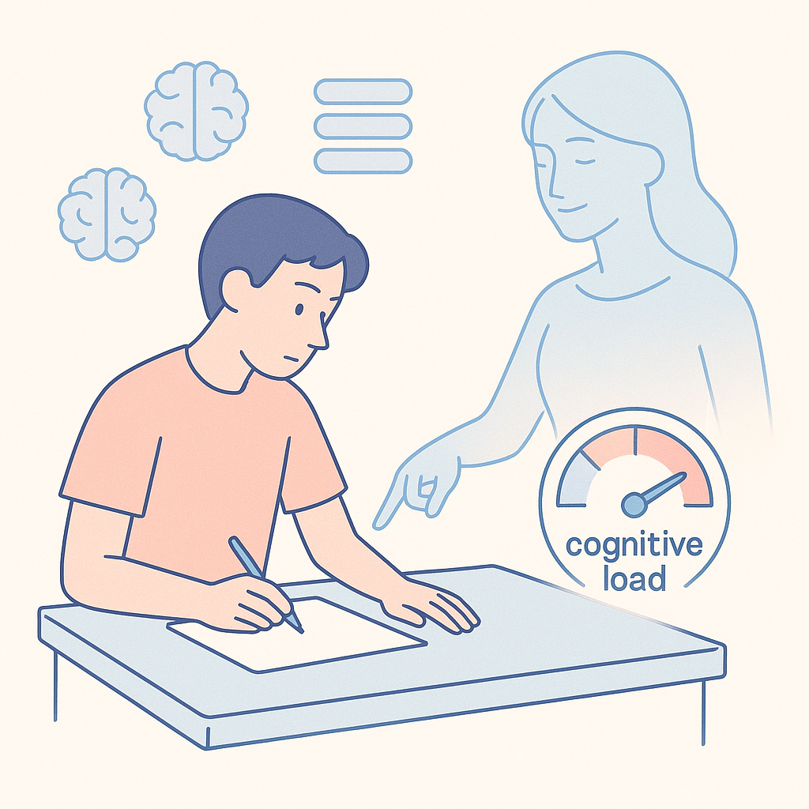

# **인지 부하 이론과 스캐폴딩 효과: 이론에서 실전, 그리고 최신 연구까지**

---

## **1. 스캐폴딩과 인지 부하, 왜 중요한가?**

지식과 정보의 홍수 시대에 우리는 **더 많이, 더 빠르게** 배우는 것이 중요하다고 착각하기 쉽습니다. 하지만 실제로는,

**학습자의 작업 기억(working memory) 용량은 한정**되어 있고,

여기에 과도한 정보를 한 번에 집어넣으면 **인지적 혼란과 학습 방해**가 발생합니다.

이때, **스캐폴딩(Scaffolding)**이라는 개념이 핵심적인 역할을 합니다.

스캐폴딩은 단순한 ‘도움’이 아니라, **학습자의 현재 역량과 상황을 진단하여 ‘인지 부하’를 조절**해 주는 **지적 안전망**입니다.

> “스캐폴딩이란, 학습자가 혼자 해결하기 어려운 과제에 도전할 때,

> 적절한 시점과 범위에서 임시적 지원을 제공해

**인지 부하를 효과적으로 분산**

> 학습의 몰입과 지속성을 높이는 전략적 장치다.”

이 개념은 오늘날 인공지능 기반 맞춤형 교육, 기업 리스킬링, 심지어 어린이의 창의적 놀이 교육까지,

모든 현대적 학습 환경에서 “가장 실질적이고 효과적인 학습 설계의 출발점”으로 재조명받고 있습니다.

---

## **2. 스캐폴딩 효과와 인지 부하 이론의 50년 연구사**

아래 타임라인은 스캐폴딩 개념의 진화와, 인지 부하 관리 전략의 변화, 그리고 최신 AI 기반 적용 사례까지

시대별로 한눈에 볼 수 있게 정리한 것입니다.

### **🕰️ 연구사 타임라인**

| **시기**        | **주요 연구(저자, 연도)**                   | **핵심 내용 및 기여**                 | **실무 적용/영향**                           |
|:--------------|:------------------------------------|:-------------------------------|:---------------------------------------|
| **1976**      | Wood, Bruner, Ross                  | “스캐폴딩” 개념 최초 제시, ZPD(비고츠키)와 연결 | 문제 해결 과정에서 단계별 지원, 임시적 도움의 중요성 강조      |
| **1988**      | Sweller                             | 인지 부하 이론(CLT) 정립, 작업기억 한계 공식화  | 정보의 양이 아니라, ‘부하 관리’가 학습 설계의 핵심임을 명확화   |
| **2003**      | van Merriënboer 등                   | 복합학습 및 조직적 스캐폴딩 설계, 모듈화와 체계화   | 실제 교육·훈련 현장에서 단계적, 맞춤형 지원의 실용적 지침 제공   |
| **2004**      | Azevedo, Cromley                    | 디지털/AI 기반 자기조절 스캐폴딩, 하이퍼미디어 적용 | IT/디지털 학습에서 실시간 맞춤 지원, 자동화 스캐폴딩 연구 촉진  |
| **2011**      | Roll, Aleven 등                      | AI 튜터 기반 메타인지 피드백 및 스캐폴딩 자동화   | 지능형 튜터, MOOC 등 대규모 시스템의 맞춤형 부하 조절 구현   |
| **2024**      | Faber et al., Khasawneh & Khasawneh | 적응형/맞춤형 스캐폴딩, 특수교육·의료게임 실증     | 실제 성과 개선 및 ‘개인화된 부하 관리’ 도구 개발          |
| **2024~2025** | Jin et al., Nasri, CLAM 프레임워크       | LLM/VR/AI 기반 실시간 스캐폴딩, 생체신호 활용 | 실시간 부하 측정-조절, AI/VR 연동 학습, 자동화 교육설계 지침 |

### **주요 흐름 정리**

- **1970~80년대**: 스캐폴딩이 ‘임시적 발판’에서 ‘인지적 안전망’으로 개념 확대.
- **1990~2000년대**: CLT와 통합, 학습과제 난이도 조절과 맞춤형 지원 강조.
- **2010년대 이후**: AI, 디지털, 자동화, 실시간 피드백 등 첨단기술과 결합해
‘스캐폴딩의 고도화/정교화/개인화’가 핵심 트렌드로 부상.

---

## **3. 최신 연구 동향과 실전 전략**

### **(1) 최신 연구 트렌드**

1. **적응형/맞춤형 스캐폴딩**
- 게임 기반 학습, 의료 시뮬레이션, 특수교육 등에서 학습자 상태와 반응에 따라 실시간 지원을 조절하는 방식이 주류.
- **실제 결과:** 몰입도, 학습 지속성, 개별 학습 효율성 모두 유의미하게 상승함.
1. **AI/LLM/VR 기반 실시간 스캐폴딩**
- LLM 기반 teachable agent, VR에서의 생체 신호 기반 인지 부하 측정 등 첨단기술이 접목.
- **CLAM(Cognitive Load-Aware Modulation)** 등 복합 이론 프레임워크가 제시되어,
학습 맥락에 맞는 자동화된 인지 부하 관리·지원 시스템의 실증적 타당성을 확보.

1. **실시간 인지 부하 측정 및 피드백**
- 심박, 시선추적, 뇌파 등 신체신호를 이용해 즉각적으로 학습 난이도와 지원 강도를 조정.
- **예시:** VR 기반 의료 훈련, AI 튜터 기반 개별 학습 상황 분석
---

### **(2) 실전적 적용 포인트 – 구체적 전략 제시**

### **1)**

### **단계별 스캐폴딩 설계법**

- **초기 단계:**
- 개념 도입, 예시 제공, 문제 풀이 시 가이드라인 및 즉각적 피드백 제공
- 예: 단계별 힌트, 예제 분석, 템플릿 제공
- **중간 단계:**
- 학습자가 일부 독립적으로 시도하도록 유도, 필요한 경우만 추가 지원
- 예: 선택적 힌트, 점진적 문제 난이도 증가, 자기 점검 체크리스트 활용
- **최종 단계:**
- 지원 없이, 또는 최소 지원 하에 자기주도적 문제 해결 유도
- 예: 유사한 과제 반복, 결과물 자기평가, 동료와 피드백 교환
### **2)**

### **AI 및 디지털 환경에서의 실시간/맞춤형 적용**

- **AI/LLM 기반 튜터:**
- 대화형 인터페이스로 학습자의 질문·오답·반응 데이터에 따라 지원 강도와 내용 즉시 조절
- 예: “다음 단계를 직접 설명해 볼래요?”, “어떤 부분이 어려웠나요?” 등 메타인지 유도
- **VR/AR 학습:**
- 시선, 행동, 생체 신호를 활용해 실시간 인지 부하 분석 및 컨텐츠 난이도 동적 조절
- 예: “집중도가 떨어지면 자동으로 과제 난이도 하향, 몰입도가 높으면 단계적 상승”
- **특수교육/성인교육:**
- 장애, 연령, 배경지식 등 학습자 다양성에 맞춘 개인화 스캐폴딩
- 예: 디지털 피드백, 영상 가이드, 오프라인 튜터링의 하이브리드 전략
### **3)**

### **실행을 위한 체크리스트**

- (1) **학습 목표와 과제 난이도를 명확히 구분하고, 단계적 설계를 시각적으로 문서화**
- (2) **학습자의 선지식, 역량, 감정 상태 등 진단 정보를 수집·반영**
- (3) **단계별로 인지 부하를 측정(가능하다면 실시간, 최소한 피드백 기반)**
- (4) **지원(스캐폴딩)을 ‘점진적으로 줄여나가는’ 계획을 반드시 포함**
- (5) **최종적으로 ‘독립적 문제해결’ 능력 배양이 이루어지는지 확인**
---

## **4. 결론: 인지 부하를 줄이는 스캐폴딩이 곧 ‘성장 발판’이다**

최신 학습 과학은 **‘많이 가르치는 것’보다 ‘소화 가능한 만큼, 단계적으로, 지원을 줄이며’ 가르치는 것**이

결국 더 높은 성과와 자율성을 보장한다는 사실을 명확히 보여줍니다.

### **실무 메시지 요약**

- **스캐폴딩은 단순한 힌트가 아니라,**
**‘학습자의 인지 부하를 관리하는 설계적·전략적 장치’다.**

- **적절한 스캐폴딩 없이 진행되는 교육·훈련은**
**정보의 과잉, 흥미 저하, 자율성 상실로 이어질 위험이 크다.**

- **AI·디지털 기반의 자동화 스캐폴딩 전략은**
**맞춤형 학습·실시간 부하 조절·최적화된 성과 관리로 진화 중이다.**

- **이제 중요한 것은 ‘얼마나 많은 정보를 주느냐’가 아니라**
**‘얼마나 소화 가능한 단위로, 부담을 조절하며 성장시킬 것인가’이다.**

---

### **📑 참고자료 및 추천 리딩**

- Sweller, J. (1988). *Cognitive load during problem solving*
- Wood, D., Bruner, J.S., & Ross, G. (1976). *The role of tutoring in problem solving*
- van Merriënboer, J.J.G. et al. (2003). *Instructional Design for Complex Learning*
- 최신 사례: Faber et al. (2024), Jin et al. (2025), CLAM Framework (2024)
---

