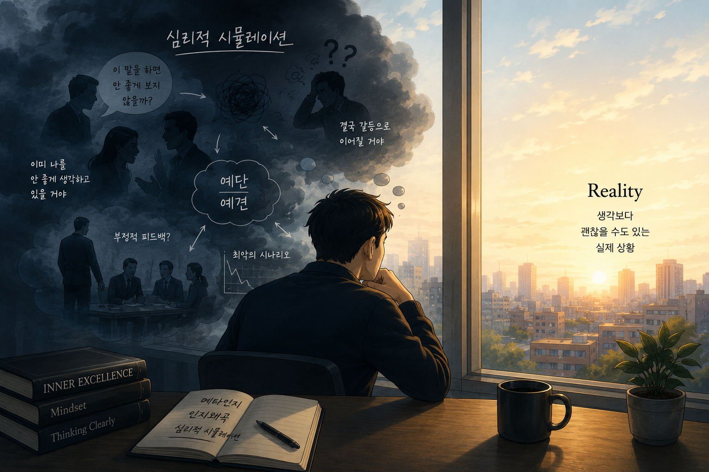
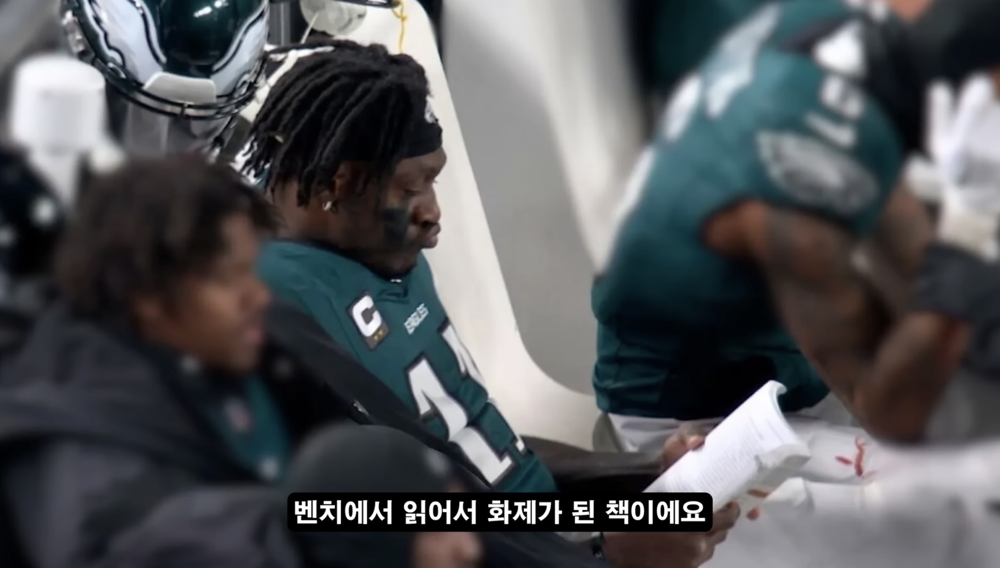
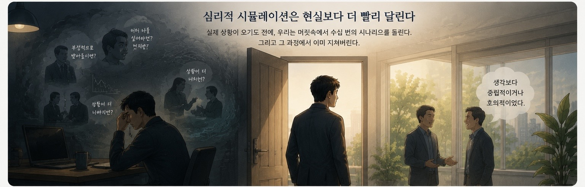
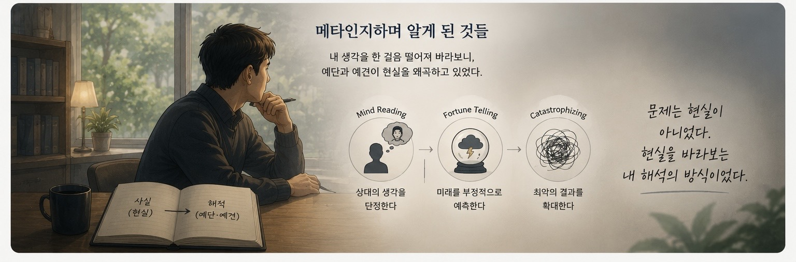

# **인지왜곡을 메타인지하며 알게 된 것들**

**예단은 어떻게 현실을 왜곡하는가**

최근 『Inner Excellence(내면 근력)』라는 책을 읽고 있다.

사실 처음 이 책을 알게 된 건 책 자체 때문은 아니었다.

유튜브에서 Real Madrid의 최근 문제를 다루는 영상을 보다가 우연히 언급된 것이 시작이었다. 영상 속 유튜버는 선수들의 심리 상태와 압박감에 대해 이야기하면서 이 책을 추천했다.

그 장면이 인상적이었다.

특히 한 유명한 미식축구 선수가 수만 명이 지켜보는 경기 도중, 벤치에서 조용히 이 책을 읽고 있었다는 이야기가 오래 기억에 남았다. 엄청난 압박과 소음 속에서도 마음을 다스리기 위해 책을 펼쳤다는 그 장면이 이상하게 머릿속에 남아 있었다.

나도 책을 읽기 시작했다.

하지만 예전보다 긴 시간 집중해서 책을 읽는 일이 쉽지 않았다. 결국 전자책 앱의 TTS 기능을 켜고 AI 음성으로 듣기 시작했다. 샤워하거나 자기 전에 조금씩 들었고, 어느새 절반 정도를 읽게 되었다.

그런데 책의 내용보다 더 오래 남은 건, 오히려 책을 읽는 동안 떠오른 내 자신의 모습이었다.

# **나는 왜 항상 최악의 시나리오를 먼저 상상했을까**

나는 오랫동안 어떤 행동을 하기 전에 지나치게 많은 생각을 하는 사람이었다.

특히 회사생활에서 그랬다.

동료와 대화하기 전에도,

다른 팀과 협업 요청을 하기 전에도,

상사에게 의견을 이야기하기 전에도,

나는 실제 대화보다 먼저 머릿속에서 수십 번의 시뮬레이션을 돌렸다.

‘이 말을 하면 부정적으로 받아들이지 않을까.’

‘이미 나를 안 좋게 생각하고 있는 건 아닐까.’

‘아마 결국 갈등으로 이어질 거야.’

이상하게도 나는 실제 현실보다, 아직 일어나지도 않은 미래를 먼저 살아내고 있었다.

문제는 그런 사고 패턴이 너무 자연스러워졌다는 점이다.

너무 익숙해서, 그것이 실제 현실이라고 착각할 정도였다.

그런데 최근 들어 나는 이런 내 생각을 조금 떨어져서 바라보기 시작했다.

어쩌면 이것은 단순한 성격 문제가 아니라, 내가 오랫동안 반복해온 어떤 사고 패턴일 수도 있겠다는 생각이 들었다. 그리고 그 순간부터 나는 내 생각 자체를 관찰하기 시작했다.

일종의 메타인지(meta cognition)였다.

# **심리적 시뮬레이션은 현실보다 더 빨리 달린다**

메타인지적으로 내 사고를 바라보기 시작하자 흥미로운 사실이 보이기 시작했다.

나는 현실을 경험하기 전에, 먼저 머릿속에서 현실을 시뮬레이션하고 있었다.

실제 대화가 시작되기 전에 이미 상대의 표정을 예측했고,

답변을 상상했고,

갈등의 가능성을 계산했고,

부정적인 결론까지 미리 도달해 있었다.

그리고 그 과정 속에서 이미 감정 에너지를 상당 부분 소모하고 있었다.

실제 업무보다,

실제 인간관계보다,

어쩌면 나를 더 지치게 만든 것은 이 ‘심리적 시뮬레이션’ 자체였는지도 모른다.

그런데 더 놀라운 사실은, 막상 현실에서는 내가 예상했던 최악의 상황이 거의 일어나지 않았다는 점이었다.

상대는 내가 생각했던 것처럼 나를 공격하려 하지 않았고,

내 의견을 무조건 부정하려 하지도 않았으며,

생각보다 훨씬 중립적이거나, 때로는 호의적이기까지 했다.

물론 모든 관계가 좋은 것은 아니다.

갈등도 있고, 불편한 사람도 있다.

하지만 적어도 내가 머릿속에서 만들어낸 “최악의 상대”는 현실에 존재하지 않는 경우가 훨씬 많았다.

어쩌면 내가 두려워했던 것은 현실 속 상대가 아니라,

내 머릿속에서 반복적으로 재생되던 상상의 상대였는지도 모른다.

# **메타인지하며 알게 된 것들**

심리학에서는 이런 경향을 “인지 왜곡(Cognitive Distortion)”이라고 부른다고 한다.

특히 다음과 같은 패턴들과 닮아 있었다.

- 상대의 생각을 단정하는 Mind Reading
- 미래를 부정적으로 예측하는 Fortune Telling
- 최악의 결과를 확대하는 Catastrophizing
이 개념들을 보며 조금 놀랐다.

나는 그동안 꽤 논리적으로 사고한다고 생각했는데, 정작 인간관계에서는 실제 현실보다 내 해석과 예견을 더 믿고 있었던 셈이었기 때문이다.

그리고 여기서 한 가지 더 흥미로운 생각이 들었다.

만약 상대방도 나와 비슷한 사고 패턴을 가진 사람이라면 어떨까?

상대도 나를 부정적으로 예상하고,

나도 상대를 부정적으로 예상한다면?

실제 대화는 거의 없는데,

짧은 메시지 하나,

무표정한 표정 하나,

짧은 침묵 하나만으로도,

서로가 서로를 오해하기 시작할 수도 있다.

현실에서는 아무 일도 일어나지 않았는데, 각자의 머릿속에서는 이미 갈등이 진행되고 있는 것이다.

생각해보면 회사생활에서의 많은 피로는 실제 업무 자체보다, 이런 보이지 않는 심리적 시뮬레이션에서 오는 것일지도 모른다.

# **예단은 어떻게 현실을 왜곡하는가**

메타인지적으로 내 사고를 바라보면서 가장 크게 느낀 것은 이것이었다.

예단은 단순한 예측이 아니었다.

그것은 아직 오지 않은 현실을 미리 감정적으로 경험하게 만드는 일이었다.

나는 현실을 객관적으로 보고 있다고 생각했지만, 실제로는 예단과 예견을 통해 현실을 먼저 왜곡하고 있었던 셈이다.

‘상대는 분명 부정적일 것이다.’

‘결국 안 좋은 방향으로 갈 것이다.’

이런 예견은 현실을 분석하는 것이 아니라, 현실을 특정 방향으로 해석하게 만드는 프레임에 가까웠다.

문제는 현실 자체보다, 그 현실을 바라보는 내 해석의 방식이었는지도 모른다.

그리고 이런 왜곡은 행동에도 영향을 준다.

사람은 자신이 예상한 현실에 맞춰 행동하기 때문이다.

이미 부정적인 결과를 확신하고 있으면,

더 방어적으로 말하게 되고,

더 위축되고,

더 조심하게 된다.

결국 그런 태도가 실제 관계의 긴장감을 만들어내기도 한다.

아이러니하게도, 내가 피하려 했던 결과를 내 스스로 만들어내는 셈이다.

# **생각보다 행동이 먼저 필요한 순간들**

40대 중반에 접어들면서 나는 점점 더 생각이 많아진 것 같다.

경험이 쌓일수록 사람은 더 빨리 예측하게 된다.

어떤 상황이 오면 결과를 미리 예상하고,

문제가 생길 가능성을 먼저 계산하고,

위험을 사전에 피하려고 한다.

그 능력은 분명 업무적으로 도움이 된다.

실제로 많은 시행착오를 줄여주기도 한다.

하지만 동시에 부작용도 있었다.

생각이 행동보다 앞서기 시작한 것이다.

실행하기 전에 너무 많은 가능성을 검토했고,

행동하기도 전에 이미 지쳐버렸으며,

실제 문제보다 머릿속 문제에 더 많은 에너지를 쓰고 있었다.

어쩌면 나는 현실을 사는 시간보다, 현실을 예견하는 시간 속에 더 오래 머물러 있었는지도 모른다.

그래서 요즘은 조금 다른 방향을 연습해보려고 한다.

머릿속에서 사람을 상대하기보다, 실제 사람과 대화하기.

최악의 시나리오를 먼저 상상하기보다, 실제 반응을 먼저 확인하기.

생각보다 행동을 조금 앞에 두기.

물론 하루아침에 바뀌지는 않을 것이다.

하지만 적어도 이제는 안다.

내가 싸우고 있었던 대상 중 많은 부분은 현실이 아니라, 내 머릿속 끝없는 심리적 시뮬레이션이었다는 것을.

