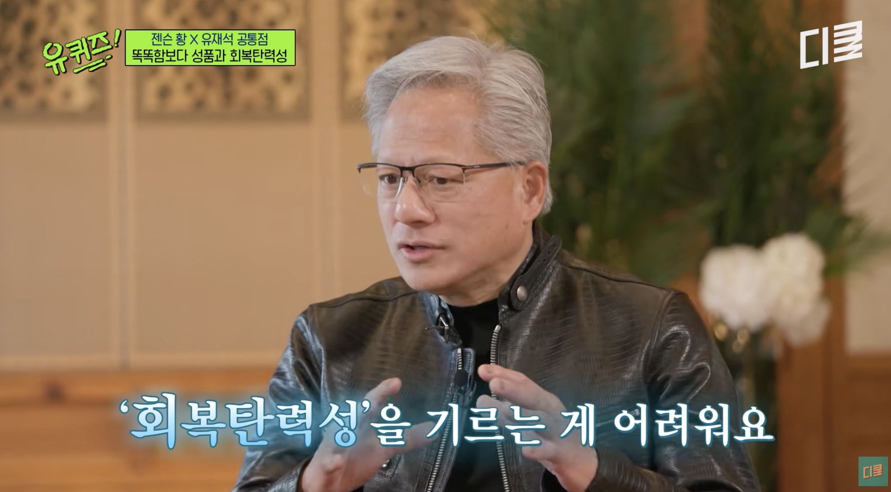
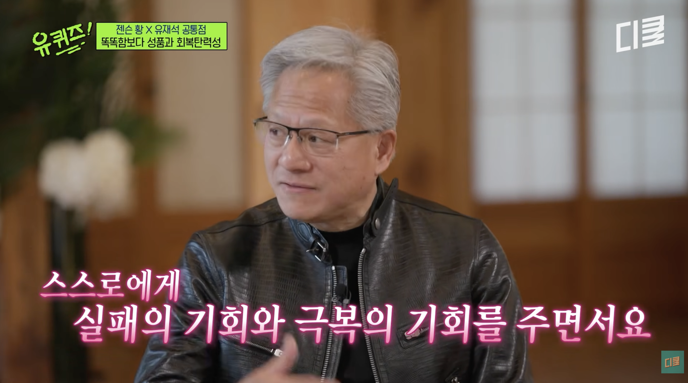

# 유퀴즈 젠슨 황이 증명한 단 하나의 무기, 그리고 나의 기록들이 가리키던 '리질리언스(Resilience)'

최근 방영된 유퀴즈 온 더 블럭의 젠슨 황 엔비디아 CEO 인터뷰는 수많은 화제를 낳았습니다. 방송에서 그가 들려준 많은 이야기 중에서도 제 머리를 가장 강하게 때린 핵심 단어는 단연 '회복탄력성(Resilience)'이었습니다.

무엇보다 놀라운 것은, 제가 과거에 블로그에 써두었던 여러 편의 글과 파편화된 통찰들이 비로소 '리질리언스'라는 하나의 본질로 선명하게 꿰어졌다는 점입니다. 마치 흩어져 있던 날갯짓들이 하나의 이름으로 명명되며 온전한 의미를 갖게 된 기분입니다.

### 1. 지능의 시대, 당신의 캐릭터는 무엇인가?

유퀴즈 인터뷰에서 젠슨 황은 AI와 인터넷의 발전으로 인해 지능의 가치가 근본적으로 변했다고 단언합니다. 진정한 차별화는 지능이 아닌 다른 곳에서 온다는 것이죠.

- **지식과 지능의 대중화 (Intelligence is a commodity)**
> "Intelligence is a commodity. Intelligence is available everywhere. There are so many great universities, so many great students, millions and millions of them. ... And now, artificial intelligence is a commodity." 

[youtube.com/watch?v=TwteDNIp61c&time_continue=127](https://youtube.com/watch?v=TwteDNIp61c&time_continue=127&source_ve_path=MjM4NTE&embeds_referring_euri=https%3A%2F%2Fapp.notion.com%2F)

인공지능(AI)과 인터넷의 발전으로 고도의 지능, 지식, 정보는 이미 세상에 널려 있는 흔한 재화(Commodity)가 되었습니다. 누구나 쉽게 지식에 접근할 수 있는 시대에, 더 이상 지능의 양만으로는 차별화를 만들 수 없습니다.

- **차별화는 캐릭터와 리질리언스에서 온다 (Character is hard, resilience is hard)**
> "Human character is special. ... Knowledge is easy. We have internet, we have lots of access of information. But character is hard, resilience is hard. That can only be galvanized, shaped through life experience and giving yourself the opportunity to fail and come back, fail and come back." 

진정한 차별점은 지식의 양이 아니라 인간의 '품성(Character)'과 '회복탄력성(Resilience)'에 있습니다. 이는 책상 앞이 아니라, 오직 삶의 경험 속에서 실패하고 다시 돌아오고, 또 실패하고 다시 돌아오는(Fail and come back) 처절한 과정을 통해서만 단단하게 형성(Galvanized)됩니다.

### 2. 실패의 비난을 온몸으로 견디고 다시 돌아오는 힘

최고의 자리에 있는 사람도 실패를 피할 수는 없습니다. 젠슨 황은 실패했을 때 마주해야 하는 끔찍한 무게를 솔직하게 고백합니다.

"성공했을 땐 수많은 사람들의 공이지만, 실패했을 때 세상은 오직 최고 책임자인 저 한 사람만을 바라보고 비난을 퍼붓습니다. 그래서 저는 그 막중한 비난(criticism)과 대중 앞에서의 당혹감(embarrassment), 그리고 실패를 온전히 견뎌낼 만큼 강인해져야(strong enough) 합니다. 그럼에도 불구하고 끊임없이 다시 돌아와 더 나은 결과를 위해 시도하는 것(keep coming back and trying), 그것이 바로 책임입니다." 

[https://www.youtube.com/watch?v=-qXDdToZHzE&t=3138s](https://www.youtube.com/watch?v=-qXDdToZHzE&t=3138s)

이러한 그의 철학은 명연설로 회자되는 스탠포드 출신으로서의 캘텍(Caltech) 졸업 축사에서도 고스란히 이어집니다. 그는 수재들이 모인 졸업식장에서 자신의 진정한 초능력을 이렇게 정의했습니다.

"제가 가진 능력 중 가장 가치 있게 여기는 것은 결코 지능(intelligence)이 아닙니다. 저의 가장 강력한 초능력(superpowers)은 고통과 고난을 견뎌내는 능력(endure pain and suffering)과, 좌절 속에서도 모퉁이 너머의 기회를 찾아내는 능력입니다." 

### 3. 나의 과거 기록들이 가리키던 단 하나의 과녁, 리질리언스

젠슨 황의 깊은 통찰을 접하는 순간, 제가 그동안 끄적였던 글들이 퍼즐처럼 맞춰졌습니다. 이승건 대표, 주언규 대표, 박경철 원장이 각기 다른 분야에서 강조했던 성공의 법칙들이 결국은 '리질리언스'의 다른 이름이었음을 비로소 깨달았습니다.

- **이승건의 '끈기' (리질리언스의 내면적 태도):** 토스 이승건 대표는 창업 전 6년 동안 8번을 연달아 실패했습니다. 그는 실패했던 과거의 자신과 성공한 현재의 자신 사이에 지능이나 네트워크의 차이는 없었으며, 오직 '끈기'의 차이만 있었다고 증언합니다. 성공의 99%는 운이며 , 언제 올지 모르는 그 운의 타이밍을 맞이할 때까지 버티는 힘. 이것이 바로 젠슨 황이 말한 "실패를 견디고 계속해서 다시 시도하는(keep coming back and trying)" 내면적 리질리언스입니다.
- [https://gunn.kim/posts/business-is-luck/](https://gunn.kim/posts/business-is-luck/)
- **주언규의 '작은 사업' (리질리언스의 구조적 구현):** 주언규 대표는 사업의 본질이 확률 게임이라며, 10명 중 9명이 망한다면 10번 이상 시도할 수 있는 아주 작은 규모의 사업을 해야 한다고 강조했습니다. 전 재산을 걸고 단 한 번 주사위를 던지는 것은 요행을 바라는 것이지만 , 주사위를 여러 번 던질 수 있는 기회를 세팅하면 우연은 필연의 영역으로 바뀝니다. 이는 철저히 "fail and come back" 할 수 있는 기회를 구조화시킨 완벽한 리질리언스 전략입니다.
- [https://gunn.kim/posts/sinsaimdang-youtuber-insight/](https://gunn.kim/posts/sinsaimdang-youtuber-insight/)
- **박경철의 '현실적 캐시플로우' (리질리언스의 방어막):** 아무리 단단한 품성(Character)을 가졌더라도 현실이 무너지면 버틸 수 없습니다. 박경철 원장은 장기투자 실패의 진짜 이유가 결혼, 치료 등의 돌발 상황으로 인해 강제로 자금을 빼야 하는 구조적 취약성에 있다고 지적합니다. 안정적인 본업과 비상 자금을 바탕으로 한 현실적인 캐시플로우 창출. 이것은 시장의 풍파 속에서도 나의 자산과 멘탈이 강제 청산당하지 않도록 지켜주는 리질리언스의 물리적 토대입니다.
- [https://gunn.kim/posts/w-cashflow-success/](https://gunn.kim/posts/w-cashflow-success/)

### 결론: 우리는 어떤 무기를 갈고닦아야 하는가

이제 고도의 지능과 지식은 커모디티(Commodity)가 되어 누구나 마음만 먹으면 AI를 통해 곁에 둘 수 있는 세상입니다. 비즈니스와 투자, 그리고 거친 인생의 기로에서 진정한 차별화를 만들어내는 열쇠는 지능의 양이 아닙니다.

실패의 뼈아픈 비난과 고통을 온몸으로 견뎌내는 강인한 인격(Character). 쓰러져도 10번이고 다시 일어날 수 있게 해주는 끈기와 현실적인 캐시플로우 시스템.

제가 그동안 막연하게 맴돌던 생각의 파편들은 결국 젠슨 황이 평생의 삶과 비즈니스를 통해 증명해 낸 위대한 본질, '리질리언스(Resilience)'를 향하고 있었습니다. 우리는 요행을 쫓거나 지능에 취할 것이 아니라, 무너지지 않고 언제든 다시 돌아올 수 있는 복원력의 구조를 짓는 일에 매진해야 합니다.

