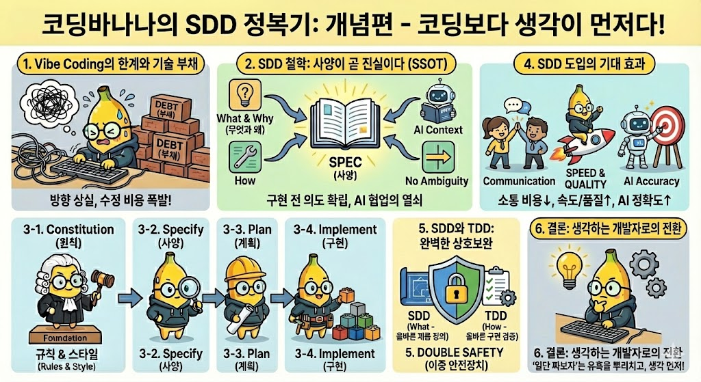

### 1. 'Vibe Coding'의 한계와 SDD의 필요성

우리는 종종 무엇을 만들지 명확히 정의하지 않은 채 코드부터 작성하는 'Vibe Coding'의 함정에 빠집니다.

좋은 아이디어가 떠오르면 에디터를 열고 즉시 키보드에 손을 올리는 것은 개발자의 자연스러운 본능이지만, 이는 종종 프로젝트의 방향성을 잃게 만듭니다. 명확한 청사진 없이 작성된 코드는 수정 비용이 기하급수적으로 늘어나며, 결국 갚아야 할 '기술 부채'로 남게 됩니다. GitHub이 제안하는 **Spec-Driven Development(SDD, 사양 주도 개발)**는 "구현"보다 "의도"를 먼저 확립하여 이러한 비효율을 근본적으로 차단하는 방법론입니다.

### 2. SDD의 핵심 철학: 사양이 곧 진실이다

SDD는 코드를 작성하기 전에 '무엇(What)'과 '왜(Why)'를 완벽하게 정의하여, 사양을 프로젝트의 유일한 진실(Single Source of Truth)로 만듭니다.

전통적인 개발 방식에서 사양서가 개발 후 업데이트되지 않고 버려지는 껍데기였다면, SDD에서 사양은 개발의 시작이자 끝인 중심축입니다. 이는 기술적인 구현 방법(How)에 매몰되기 전에 비즈니스 요구사항과 사용자 경험을 구체화하여 기획의 모호함을 제거하는 과정입니다. 또한 잘 작성된 사양은 사람뿐만 아니라 AI 코딩 에이전트(Copilot 등)에게도 완벽한 문맥(Context)을 제공하여 협업의 효율을 극대화합니다.

### 3. 성공적인 SDD를 위한 4단계 프로세스

SDD는 '원칙 수립(Constitution) -> 사양 정의(Specify) -> 기술 계획(Plan) -> 구현(Implement)'의 흐름을 통해 추상적인 아이디어를 구체적인 코드로 변환합니다.

첫째, Constitution 단계에서는 프로젝트 전반에 적용되는 불변의 규칙, 코딩 스타일, 성능 목표 등을 정의하여 팀의 그라운드 룰을 세웁니다. 둘째, Specify 단계에서는 구현 디테일을 철저히 배제하고 기능적 요구사항과 사용자 시나리오를 작성하여 '무엇'을 만들지 합의합니다. 셋째, Plan 단계에 이르러서야 합의된 사양을 바탕으로 아키텍처, 데이터 모델, API 등 기술적 실행 계획을 수립합니다. 마지막으로 Implement 단계에서 계획을 작은 작업 단위로 쪼개고 실제 코드를 작성합니다.

### 4. SDD 도입의 기대 효과

명확한 사양은 커뮤니케이션 비용을 획기적으로 줄이고, 재작업을 방지하여 개발 속도와 품질을 동시에 높입니다.

'글(Spec)'을 수정하는 것은 이미 작성된 '코드'를 뜯어고치는 것보다 비용이 훨씬 저렴하므로, 설계 단계에서의 검증은 필수적입니다. 특히 AI 도구를 활용할 때 명확한 사양은 정교한 프롬프트 역할을 하여 환각 현상을 줄이고 결과물의 정확도를 높여줍니다. 이는 팀원 간의 오해를 줄이고, 최종 결과물이 당초 의도와 일치하는지 지속적으로 확인하는 프로젝트의 나침반이 됩니다.

### 5. SDD와 TDD: 대립이 아닌 상호보완

SDD와 TDD(Test-Driven Development)는 대체재가 아니며, 각각 '올바른 제품 정의(Validation)'와 '올바른 구현 검증(Verification)'을 담당하는 상호보완적 관계입니다.

SDD는 코딩 전에 "무엇을 만들 것인가"를 정의하여 기획의 모호함을 없애는 데 집중하고(Building the right product), TDD는 그 정의된 기능을 "어떻게 결함 없이 구현할 것인가"에 집중합니다(Building the product right). SDD 단계에서 작성된 명확한 사양(Spec)은 TDD 단계에서 테스트 케이스를 작성하는 직접적인 기준(Criteria)이 되어, 개발자가 '무엇을 테스트해야 하는가'에 대한 고민을 덜어줍니다. 결국 SDD로 설계의 논리적 오류를 막고, TDD로 코드의 기능적 오류를 막는 강력한 '이중 안전장치'를 구축하게 됩니다.

### 6. 결론: 생각하는 개발자로의 전환

SDD는 단순한 문서화 과정이 아니라, 더 나은 소프트웨어를 만들기 위한 '생각의 틀'을 정립하는 문화입니다.

코드를 빨리 치는 물리적 속도보다, 올바른 문제를 정의하고 최적의 해결책을 설계하는 사고력이 엔지니어의 진짜 역량입니다. '일단 짜보자'는 유혹을 뿌리치고, 지금 바로 작은 기능부터 SDD를 적용하여 '생각하고 코딩하는' 습관을 시작해 보시길 권합니다.

---

