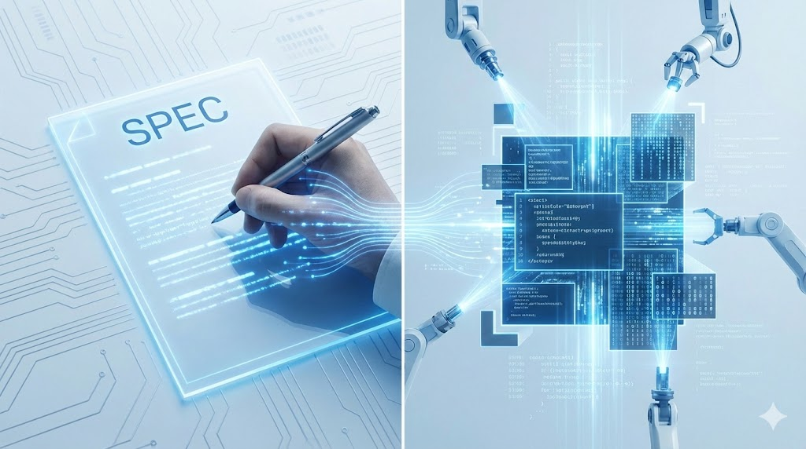
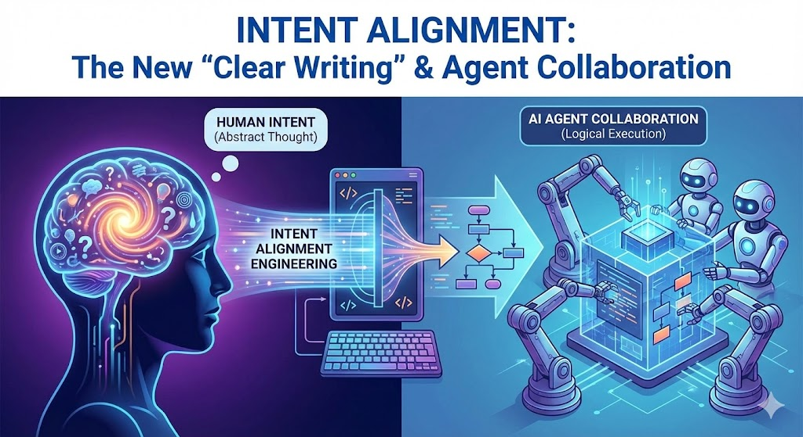

## **"The Prompt Is the Source Code" (Spec is the Source)**

### **On the Fundamental Change in How We Work in the AI Era**

Since generative AI arrived, the tech industry and research community have been full of voices mixing hope and worry. Opinions range from the extreme prediction, "Won't we soon have no need for developers or data analysts?", to the cautious view, "It's still just a tool."

But people who have worked with AI in depth in the field instinctively feel a huge current of change. It is the fact that **the work's 'bottleneck' is shifting completely**.

In the past, the bottleneck was 'implementation': turning an idea into a working result. We spent most of our time writing code, debugging, and preprocessing data. The spec was just a preparatory step toward implementation, and was often treated as annoying paperwork.

But AI is pushing the cost of this 'implementation' close to zero. Now the bottleneck has moved away from 'how to build it (How)' to **the stage of defining 'what to build (What)'**.

Here we encounter a new paradigm: the idea that **"the prompt (the spec) is the source code (Spec is the Source)."**

### **A Paradigm Shift: From Binary to Source Code**

Let's use an analogy from traditional software development. A programming language like C or Java, written by humans, is the 'source code.' It is the origin that holds human intent and logic. A computer compiles this source code into a 'binary' (an executable file) that a machine can understand. A binary is a derived artifact that can be regenerated at any time as long as you have the source code.

In the AI era, this relationship is turned upside down.

- **The new source code (Source):** The natural-language prompts we write and the detailed spec become the original source that carries human intent.
- **The new binary (Binary):** The Python code, SQL queries, draft reports, and so on that AI generates in an instant from the prompt become the compiled output, that is, the binary.
When we are unhappy with the result, we should not 'patch' by forcibly rewriting the code the AI spat out. That is like editing an executable with a hex editor. Instead, we should fix the origin, the 'prompt (Spec).' This is debugging in the new era.

### **Beyond 'Clear Writing': Intent Alignment and Agent Collaboration**

The 'writing' in this new paradigm is not simply the skill of polishing sentences until they read smoothly. It is **'Intent Alignment' engineering**: converting abstract human thoughts into logical instructions that AI can carry out without misunderstanding.

The new technical skills we need to develop take shape in the following three dimensions.

1. The ability to keep results 'On-Track'

AI is a probabilistic model. Without clear guidance, it easily produces plausible wrong answers or veers off in odd directions. So the most important skill is the ability to design 'constraints' that properly control AI's creativity and make it move only as we intend.

We need to be designers, not literary authors. Instead of "analyze this," we have to define the scope of the data, the outliers to exclude, and a strict structure for the output format, so that the result lands on the track we want.

2. Establishing a protocol with AI and the ability to converse with it

It is rare for a single perfect prompt to settle things. The iterative dialogue, the constant back-and-forth with AI to reach the result we want, is itself a development process.

In this process we learn the most efficient way of speaking to AI and the most efficient procedures for assigning it work, in other words, a protocol. Feeding AI's answers back in as input to fix errors, or getting it to ask about ambiguous parts on its own, makes 'conversing to collaborate with machines' an important skill set in itself.

3. Automating communication through agents

Going further, we won't even do this communication ourselves. Simple coding will be done by 'coding agents,' and the role of assigning work to those agents and reviewing it will fall to 'PM agents' or 'QA agents.'

In the future, we will go beyond typing prompts ourselves and become orchestrators who decide **"which agents should we combine to solve this problem?"** The spec becomes the commander's written orders that move this army of agents.

### **Spec-Driven Work: The Direction We Should Take**

So how should our way of working change?

1. **Invest more time in the spec:** Don't jump straight into coding or tool work; focus on writing a spec that defines the essence of the problem you are trying to solve.
1. **Validate with Vibe Coding:** Before writing a perfect spec, use AI to quickly build a prototype and check whether the direction (the vibe) is right.
1. **Become the auditor:** Verifying the logical consistency of what AI produces is entirely a human job. The more we are freed from the burden of implementation, the higher the level of critical thinking required of us.
### **Proof from the Industry: GitHub's 'Spec-Driven Development'**

This change is not just theory. Even **GitHub**, the hub for developers around the world, recently [**released a Spec-Driven Development (SDD) kit**](https://github.com/github/spec-kit) based on its own internal development methodology.

With this kit, GitHub emphasizes "the process of thinking deeply about, and reaching agreement on, what you are building and why before writing code." This is decisive evidence that global tech leaders already treat the spec not as a mere document but as the core source of product development. The templates and guides they released will be an excellent reference for how we should work in a 'Spec-Driven' way.

### **Conclusion**

The AI era is not replacing humans; it is elevating the human role from 'implementer' to 'designer' and 'supervisor.'

Now, instead of a monitor full of complex code, what should sit on our desks is a single, carefully refined spec. **Because that spec is the source code of this era.**
