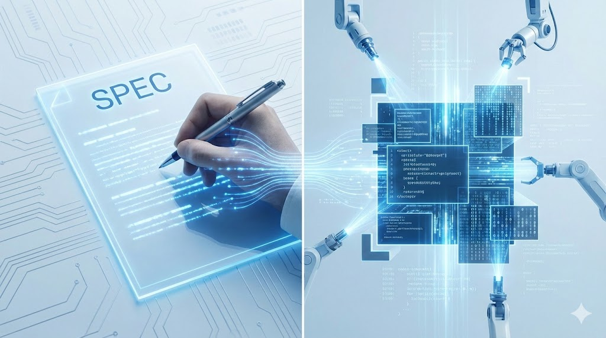
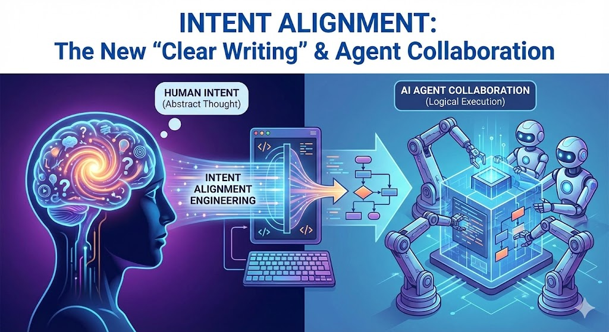

## **"프롬프트가 곧 소스코드다" (Spec is the Source)**

### **AI 시대, 우리가 일하는 방식의 근본적인 변화에 대하여**

생성형 AI가 등장한 이후, 기술 업계와 연구 분야에서는 기대와 우려가 섞인 목소리가 끊이지 않습니다. "이제 개발자나 데이터 분석가는 필요 없어지는 것 아닐까?"라는 극단적인 전망부터, "여전히 도구일 뿐이다"라는 신중론까지 다양합니다.

하지만 현장에서 AI를 깊이 있게 다뤄본 사람들은 본능적으로 느끼는 거대한 변화의 흐름이 있습니다. 그것은 바로 일의 **'병목(Bottleneck)' 지점이 완전히 이동하고 있다**는 사실입니다.

과거에는 아이디어를 실제 작동하는 결과물로 만드는 '구현(Implementation)'이 병목이었습니다. 코드를 짜고, 디버깅하고, 데이터를 전처리하는 데 대부분의 시간을 썼습니다. 기획서(Spec)는 그저 구현을 위한 준비 단계이자, 종종 귀찮은 서류 작업 취급을 받기도 했습니다.

하지만 AI가 이 '구현'의 비용을 0에 가깝게 만들고 있습니다. 이제 병목은 '어떻게 만들 것인가(How)'가 아니라, **'무엇을 만들 것인가(What)'를 정의하는 단계**로 옮겨왔습니다.

이 지점에서 우리는 새로운 패러다임을 마주합니다. 바로 **"프롬프트(기획서)가 곧 소스코드(Spec is the Source)"**라는 개념입니다.

### **패러다임의 전환: 바이너리에서 소스코드로**

전통적인 소프트웨어 개발을 비유해 보겠습니다. 인간이 작성하는 C나 Java 같은 프로그래밍 언어가 '소스코드(Source Code)'입니다. 인간의 의도와 논리가 담겨 있는 원천이죠. 컴퓨터는 이 소스코드를 컴파일하여 기계가 이해할 수 있는 '바이너리(Binary, 실행 파일)'로 변환합니다. 바이너리는 소스코드만 있으면 언제든 다시 만들어낼 수 있는 파생 결과물입니다.

AI 시대에는 이 관계가 뒤집힙니다.

- **새로운 소스코드 (Source):** 우리가 작성하는 자연어 프롬프트, 상세한 기획서(Spec)가 곧 인간의 의도를 담은 원천 소스가 됩니다.
- **새로운 바이너리 (Binary):** AI가 프롬프트를 바탕으로 순식간에 생성해내는 Python 코드, SQL 쿼리, 초안 보고서 등이 컴파일된 결과물, 즉 바이너리가 됩니다.
결과물이 마음에 들지 않을 때, 우리는 AI가 뱉어낸 코드를 억지로 뜯어고치는 '패치' 작업을 해서는 안 됩니다. 그것은 마치 실행 파일을 헥사 에디터로 수정하는 것과 같습니다. 대신, 원천인 '프롬프트(Spec)'를 수정해야 합니다. 이것이 새로운 시대의 디버깅입니다.

### **'명확한 글쓰기'를 넘어: 의도 정렬(Intent Alignment)과 에이전트 협업**

이 새로운 패러다임에서 말하는 '글쓰기'는 단순히 문장을 유려하게 다듬는 작문 실력이 아닙니다. 그것은 인간의 추상적인 생각을 AI가 오해 없이 수행할 수 있는 논리적 명령으로 변환하는 **'의도 정렬(Intent Alignment)' 엔지니어링**입니다.

우리가 갖춰야 할 새로운 기술 역량은 다음 세 가지 차원으로 구체화됩니다.

1. 결과를 'On-Track'으로 유지하는 통제력

AI는 확률적 모델입니다. 명확한 가이드가 없으면 그럴싸한 오답을 내놓거나 엉뚱한 방향으로 튀기 쉽습니다. 따라서 최고의 기술 역량은 AI의 창의성을 적절히 통제하고 우리의 의도대로만 움직이게 하는 '제약 조건(Constraints)'을 설계하는 능력입니다.

우리는 문학 작가가 아니라 설계자가 되어야 합니다. "분석해줘"가 아니라, 데이터의 범위, 제외해야 할 이상치, 출력 포맷의 엄격한 구조를 정의하여 결과물을 우리가 원하는 궤도(Track) 위에 안착시켜야 합니다.

2. AI와의 프로토콜(Protocol) 수립 및 대화 능력

한 번의 완벽한 프롬프트로 끝나는 경우는 드뭅니다. 원하는 결과에 도달하기 위해 AI와 끊임없이 주고받는 반복적 대화(Iterative Dialogue) 자체가 하나의 개발 과정입니다.

이 과정에서 우리는 AI에게 일을 시키는 가장 효율적인 화법과 절차, 즉 프로토콜을 익히게 됩니다. AI의 답변을 다시 입력으로 사용하여 오류를 수정하거나, 모호한 부분을 스스로 되물어보게 만드는 등 '기계와 협업하는 대화법' 자체가 중요한 스킬셋이 됩니다.

3. 에이전트를 통한 커뮤니케이션의 자동화

더 나아가, 이 소통 과정조차 우리는 직접 하지 않게 될 것입니다. 단순한 코딩은 '코딩 에이전트'가 하고, 그 에이전트에게 일을 시키고 검수하는 역할은 'PM 에이전트'나 'QA 에이전트'가 맡게 됩니다.

미래의 우리는 직접 프롬프트를 입력하는 단계를 넘어, **"어떤 에이전트들을 조합하여 이 문제를 해결할 것인가?"**를 결정하는 오케스트레이터(Orchestrator)가 될 것입니다. 기획서(Spec)는 이 에이전트 군단을 움직이는 사령관의 명령서가 되는 셈입니다.

### **Spec-Driven Work: 우리가 나아갈 방향**

그렇다면 우리의 업무 방식은 어떻게 변해야 할까요?

1. **Spec에 더 많은 시간을 투자하십시오:** 바로 코딩이나 툴 작업에 뛰어들지 말고, 해결하려는 문제의 본질을 정의하는 기획서 작성에 집중해야 합니다.
1. **Vibe Coding으로 검증하십시오:** 완벽한 기획서를 쓰기 전, AI를 활용해 빠르게 프로토타입을 만들어보고 방향성(Vibe)이 맞는지 확인하는 과정을 거치십시오.
1. **검증자(Auditor)가 되십시오:** AI가 만든 결과물의 논리적 정합성을 검증하는 것은 온전히 인간의 몫입니다. 구현의 부담에서 벗어난 만큼, 더 높은 수준의 비판적 사고가 요구됩니다.
### **업계의 증명: GitHub의 'Spec-Driven Development'**

이러한 변화는 단순한 이론이 아닙니다. 전 세계 개발자들의 허브인 **GitHub**조차도 최근 자신들의 내부 개발 방법론인 [**Spec-Driven Development (SDD) 킷을 공개**](https://github.com/github/spec-kit)했습니다.

GitHub는 이 킷을 통해 "코드를 작성하기 전에 무엇을 만들고 왜 만드는지에 대해 깊이 생각하고 합의하는 과정"을 강조합니다. 이는 글로벌 테크 리더들이 이미 기획서(Spec)를 단순한 문서가 아닌, 제품 개발의 핵심 원천으로 다루고 있음을 보여주는 결정적인 증거입니다. 이들이 공개한 템플릿과 가이드는 우리가 어떻게 'Spec-Driven' 방식으로 일해야 할지에 대한 훌륭한 참고 자료가 될 것입니다.

### **결론**

AI 시대는 인간을 대체하는 것이 아니라, 인간의 역할을 '구현자'에서 '설계자'와 '감독자'로 격상시키고 있습니다.

이제 우리의 책상 위에는 복잡한 코드가 적힌 모니터 대신, 정교하게 다듬어진 기획서 한 장이 놓여 있어야 합니다. **그 기획서가 바로 이 시대의 소스코드이기 때문입니다.**

