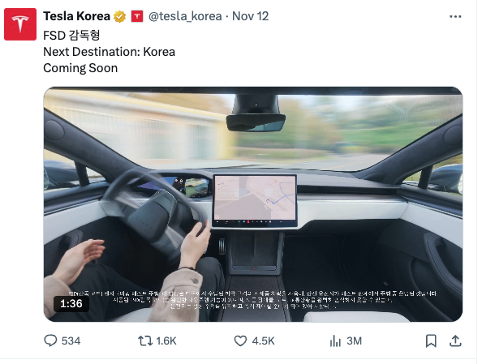

2025년 12월, 드디어 한국에도 테슬라 오너들이 오랫동안 기다려온 **'FSD(Full Self-Driving, 감독형)'**가 공식 상륙했습니다. 많은 분이 기대감에 부풀어 소프트웨어 업데이트를 확인하셨을 텐데요.

하지만 설레는 마음도 잠시, 꽤 많은 오너분들이 당혹감을 감추지 못하고 있습니다. 도로 위에서 가장 많이 보이는 최신형 **모델 3(하이랜드)**와 **모델 Y(주니퍼)**에서는 정작 FSD 활성화 버튼이 뜨지 않기 때문입니다.

*"내 차는 최신형(HW 4.0)인데 왜 안 되지?"*

단순히 업데이트 순서의 문제가 아닙니다. 여기에는 우리가 미처 몰랐던 **'생산 국가(미국 vs 중국)'**와 **'한미 FTA 인증'**이라는 복잡하지만 따지고 보면 간단한 법규 문제가 얽혀 있습니다.

이번 포스팅에서는 현재 한국에서 FSD 사용이 가능한 정확한 차종 기준과, 테슬라 코리아의 모델별 도입 변천사(미국산 초기형부터 중국산 RWD, 주니퍼까지)를 짚어보며 **내 차는 과연 언제쯤 FSD를 쓸 수 있을지** 명쾌하게 정리해 드립니다.

바쁘신 분들을 위해 결론부터 요약하고 시작합니다.

> 💡 [3줄 요약] 테슬라 FSD, 지금 누가 쓸 수 있나?

1. **가능:** 최근 인도된 **미국산 모델 S / 모델 X (HW 4.0)** 차량만 즉시 활성화 가능.
1. **불가능:** 주력 모델인 **모델 3(하이랜드)·모델 Y(주니퍼)**는 최신형이지만 **'중국산'**이라 FTA 혜택 제외로 인증 지연 중.
1. **전망:** 중국산 모델 및 구형(HW 3.0) 차량은 국토부 별도 승인 절차를 거쳐 **2026년 이후** 순차 적용 예상.

### 1. 현재 한국 FSD 사용 가능 차량 (2025년 12월 기준)

결론부터 말씀드리면, 현재 한국에서 FSD를 바로 쓸 수 있는 차량은 **최신형 미국산 모델 S와 모델 X**뿐입니다.

| **모델**          | **FSD 사용 가능 여부**   | **조건 및 이유**                              |
|:----------------|:-------------------|:-----------------------------------------|
| **Model S / X** | **가능 (일부)**        | **HW 4.0**이 탑재된 **미국산** 차량만 가능 (최근 인도분)  |
| **Model 3**     | **불가능**            | 최신형(하이랜드)도 **중국 상하이 공장** 생산분이라 제외됨       |
| **Model Y**     | **불가능**            | 주력 모델(RWD, 주니퍼)이 **중국 상하이 공장** 생산분이라 제외됨 |

### 🔍 왜 모델 3·Y(하이랜드, 주니퍼)는 안 되나? (핵심 이유)

단순히 기술 문제가 아니라 **'한미 FTA(자유무역협정)'**와 관련된 인증 규제 때문입니다.

- **미국산 차량(모델 S/X):** FTA 규정에 따라 미국 안전 기준을 충족하면 한국 규제를 일부 면제받아 FSD 기능을 바로 활성화할 수 있습니다. (연간 쿼터 내)
- **중국산 차량(모델 3/Y):** FTA 혜택을 받지 못하므로, 한국의 엄격한 자율주행 관련 법규(국토부 인증 등)를 별도로 통과해야 합니다. 이 과정이 오래 걸려 도입이 늦어지고 있습니다.
---

### 2. 테슬라 모델별 한국 출시 변천사 및 주요 특징

한국 시장에 도입된 차량들의 생산지 변화와 하드웨어(HW) 버전 흐름을 파악하시면 내 차(혹은 중고차)의 FSD 적용 가능성을 가늠하는 데 도움이 됩니다.

### **(1) Model 3 (모델 3)**

초기에는 미국산이었으나, 현재는 전량 중국산으로 전환되었습니다.

- **1기: 초기 도입분 (2019 ~ 2020)**
- **특징:** 미국 프리몬트 공장 생산 (스탠다드/롱레인지/퍼포먼스).
- **HW 버전:** HW 2.5 → HW 3.0 혼재.
- **FSD:** 하드웨어는 되지만 '미국산 구형'이라 이번 초기 배포 대상에서는 제외됨(추후 업데이트 가능성 있음).
- **2기: 리프레쉬 & 중국산 전환 (2021 ~ 2023)**
- **특징:** 롱레인지 등 주력 모델이 **중국 상하이 기가팩토리** 생산으로 변경. 단차(조립 품질)가 좋아지고 LFP 배터리(RWD)가 도입됨.
- **HW 버전:** HW 3.0.
- **3기: 하이랜드 (2024년 4월 출시 ~ 현재)**
- **특징:** 페이스리프트 모델. 승차감 개선, 통풍 시트 추가, 앰비언트 라이트 적용. **전량 중국산.**
- **HW 버전:** **HW 4.0** (최신 하드웨어).
- **상태:** HW 4.0임에도 **중국산**이라 현재 FSD 사용 불가.
### **(2) Model Y (모델 Y)**

가장 드라마틱한 변화를 겪은 모델로, '대란'을 일으킨 RWD 모델이 핵심입니다.

- **1기: 미국산 롱레인지/퍼포먼스 (2021 ~ 2022)**
- **특징:** 초기 물량은 미국산. 가격이 꽤 높았음(7~8천만 원대 이상).
- **HW 버전:** HW 3.0.
- **2기: RWD (일명 '치와이') 대란 (2023 ~ 2024)**
- **특징:** **중국 상하이 생산**. LFP 배터리를 넣어 가격을 5천만 원대로 낮추며 폭발적 인기.
- **HW 버전:** HW 3.0 또는 HW 4.0 (생산 시점에 따라 섞여 있음).
- **상태:** 중국산이라 FSD 불가.
- **3기: 주니퍼 (2025년 4월 출시 ~ 현재)**
- **특징:** 모델 3 하이랜드와 유사한 페이스리프트(헤드램프 변경, 승차감 개선). 2025년 1월 공개 후 4월부터 한국 인도 시작. **전량 중국산.**
- **HW 버전:** **HW 4.0**.
- **상태:** 최신형이지만 중국산이라 FSD 불가.
### **(3) Model S & Model X**

가장 비싼 플래그십 라인업이며, 유일하게 미국에서 계속 수입됩니다.

- **1기: 레거시 (2017 ~ 2020)**
- **특징:** 세로형 디스플레이. 구형 디자인.
- **HW 버전:** HW 2.0 ~ 3.0.
- **2기: 리프레쉬 & 플래드 (2023 ~ 현재)**
- **특징:** 가로형 디스플레이, 요크 스티어링 휠 선택 가능. 엄청난 성능(Plaid).
- **HW 버전:** 초기 인도분은 HW 3.0이었으나, 최근(2023년 후반~2024년 이후) 인도분부터 **HW 4.0** 적용.
- **상태:** **이 중 HW 4.0이 탑재된 최신 연식만 현재 FSD 사용 가능.**
---

### 요약 및 향후 전망

1. **지금 FSD 되는 차:** 최근 1~2년 내 출고된 **미국산 모델 S / X (HW 4.0)**.
1. **안 되는 차:** 한국 도로에 가장 많은 **모델 3/Y (하이랜드, 주니퍼 포함)**. 이유는 이들이 **중국산**이기 때문입니다.
1. **언제 풀릴까?:** 중국산 모델이나 HW 3.0 구형 모델에 대한 FSD 적용은 한국 국토부의 별도 승인 절차가 필요하여, 업계에서는 **2026년 이후**로 예상하고 있습니다.
현재 보유 중이시거나 구매 예정인 차량이 **모델 3 또는 Y라면, 하드웨어가 최신(HW 4.0)이라도 당분간 FSD 사용은 어렵다**고 보시면 됩니다.

#테슬라 #Tesla #FSD #자율주행 #테슬라코리아

